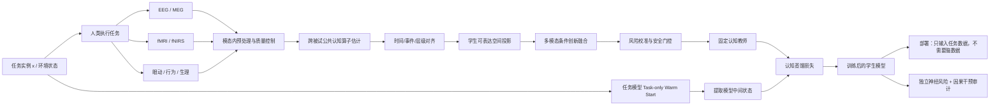

# CORTEX-LOOP：通用人类认知过程蒸馏与人脑–AI 闭环共学习范式

## 从 RELAY 静态脑轨迹蒸馏，到主动出题、在线教师构造、持续学习与独立审计

> **总范式**：CORTEX — Cross-modal, Operator-aligned, Risk-calibrated Trajectory Exchange for eXplainable AI  
> **互动扩展**：CORTEX-Loop — Closed-Loop Human Cognitive Distillation  
> **中文口号**：**先蒸馏已有的认知轨迹，再主动寻找最值得蒸馏的认知轨迹。**

---

## 文档定位与版本说明

这是一份独立、完整的研究提案文档，包含两条互补路线：

- **静态 CORTEX**：优先完成。基于固定的公共或自采脑数据，构造风险校准、学生兼容、可解释的认知教师；
- **CORTEX-Loop**：后续研究路线。让 AI 主动生成或选择下一题，人类完成任务后，系统自动处理脑数据、更新认知教师与学生模型，再决定下一次交互。

按作者提供的项目状态，RELAY 被作为已经完成的静态起点。正式投稿和公开展示前，仍建议用原始日志、数据 manifest、随机种子和统计脚本完成一次端到端一致性审计。

互动路线不会替代静态路线。静态路线更快、更便宜、更可复现；互动路线用于回答“在相同人类时间下，主动采集是否更高效”“模型能否针对自身盲点向人提问”“人脑监督与在线学习能否稳定共存”等新问题。

---

# 第一编：静态 CORTEX——通用人类认知过程蒸馏


## 0. 执行摘要

### 0.1 核心命题

今天几乎所有 AI 训练，本质上都在“蒸馏人脑”，但蒸馏的是人脑最外层、最稀疏、损失最大的一层输出：

- 文本是语言系统压缩后的离散输出；
- 标签是判断过程压缩后的一个符号；
- 点击、评分与偏好是复杂价值计算压缩后的一个标量；
- 动作轨迹是感知、预测、规划与控制共同压缩后的结果；
- 人类反馈是认知过程结束后的事后表达。

这条路线遗漏了大量位于输出之前的中间计算：注意如何移动、关系如何建立、假设如何更新、冲突如何被检测、工具如何被选择、错误如何被恢复、价值如何被权衡、空间如何在脑中被重建。

现在，EEG、MEG、fMRI、fNIRS、ECoG、sEEG、眼动、瞳孔、行为轨迹等数据，为我们提供了比文本和标签**更接近认知过程本身**的训练信号。

因此，本课题提出：

> **Human Cognitive Process Distillation，HCPD：人类认知过程蒸馏。**  
> 不要求 AI 复现神经波形，也不声称读取具体思想；而是从多人的神经活动中估计稳定、任务相关、可验证的认知结构，再把这些结构蒸馏到任意 AI 模型的中间计算中。

### 0.2 三次范式升级

| 现有范式 | CORTEX 的升级 |
|---|---|
| 从最终标签、文本、偏好学习 | 从产生这些输出的**中间认知轨迹**学习 |
| 单任务、单模态、单模型对齐 | 任务、神经模态、学生模型全部可替换 |
| 追求“脑相似度”或解码准确率 | 追求**教师风险降低、任务泛化、决策因果使用和无负迁移** |

### 0.3 RELAY 在整个计划中的位置

RELAY 已经完成了这个宏大范式的第一个严格实例：

- 任务：抽象视觉关系推理；
- 人类信号：EEG 认知轨迹；
- 学生：视觉推理模型与视觉语言模型；
- 蒸馏对象：联合“时间 × 问题”几何；
- 关键方法：跨被试无偏估计、独立队列路径选择与风险校准、学生可表达空间投影、独立参考被试审计、决策状态干预；
- 部署：推理时只输入图像，不需要 EEG。

CORTEX 的目标不是推翻 RELAY，而是把 RELAY 提炼为一组**可插拔接口和一般定理**，使它成为规划、文本推理、伦理、美学、视频、世界模型、空间导航、3D 重建、机器人控制等任务的统一底座。

### 0.4 预期最终产物

1. 一套可形式化描述的通用理论：**神经观测—任务认知—模型状态三者之间的接口演算**。
2. 一个开源框架：任务适配器、神经模态适配器、模型状态适配器、对齐器、教师构造器、风险门控器与可解释性审计器。
3. 三类代表性实证：
   - 公共数据驱动的**视频与语言跨模态验证**；
   - 自采数据驱动的**Agent 长程规划与工具使用**；
   - 高概念价值的**美学或伦理认知蒸馏**。
4. 一个跨任务的 **Cognitive Operator Bank，认知算子库**，把不同任务中的关系形成、状态更新、注意迁移、置信度、价值权衡、空间变换等结构提炼为可复用原语。
5. 一个面向公众与评审的交互式科研网站，直观展示“人脑轨迹如何成为 AI 的训练教师”。

---

## 1. 从 RELAY 到通用范式

### 1.1 RELAY 已经解决的关键难题

RELAY 的价值不只是“EEG 能提高视觉推理准确率”，而是提出了几个可以被通用化的原则：

1. **监督中间计算，而不是只监督结果。**
2. **比较关系与几何，而不是强迫脑信号和模型状态逐坐标相等。**
3. **跨被试乘积估计公共结构，避免自乘把测量噪声当成认知结构。**
4. **先确定学生的时间分辨率，再只校准它能表达的部分。**
5. **选择、校准、构造教师与独立审计必须使用统计上分离的数据。**
6. **神经对齐必须通过决策状态干预证明其被模型真正使用。**
7. **训练时可使用脑数据，部署时完全移除脑数据。**

这些原则并不依赖视觉序列题，也不依赖 EEG。

### 1.2 RELAY 与 CORTEX 的映射

| RELAY 中的对象 | CORTEX 中的一般对象 |
|---|---|
| 视觉序列题 | 任意任务分布 \(\mathcal D_\tau\) |
| 8 个 EEG 时间窗 | 任意神经时间轴、事件轴或认知阶段图 |
| 4 个视觉递归状态 | 任意模型层、token、规划节点、世界模型状态或扩散步 |
| 联合时间—问题 Gram | 任意不变量：核、距离、动态算子、事件图、因果子空间 |
| 单一 EEG 教师 | EEG、fMRI、MEG、fNIRS、ECoG 等多教师融合 |
| 离散单调路径 | 离散路径、软最优传输、事件图匹配、层—区域耦合 |
| 视觉分类交叉熵 | 分类、生成、控制、奖励、工具执行或重建损失 |
| DINOv2 工作空间 / Qwen2.5-VL | 任意可提取中间状态的 AI 模型 |
| 独立参考被试核风险 | 任意独立被试、独立模态或跨任务风险审计 |

### 1.3 研究总问题

> 是否存在一套独立于具体任务、脑成像模态与模型架构的数学接口，使我们能够把人类认知过程中稳定、任务相关、可验证的结构，安全地蒸馏到 AI 的内部计算中，并在推理时完全不依赖脑数据？

### 1.4 核心假设

- **H1：过程信号增益假设。** 在相同标签预算下，脑轨迹提供的中间结构可以提高模型对分布外结构、长程依赖和低样本任务的泛化。
- **H2：不变量优先假设。** 跨人、跨设备、跨模型最可迁移的不是原始波形或坐标，而是关系几何、动态算子、事件顺序、置信度与决策相关子空间。
- **H3：条件创新假设。** 新神经模态只有在已有模态条件下仍包含任务相关创新时才有价值；简单拼接通道数并不等于增加信息。
- **H4：学生兼容假设。** 先把教师投影到学生能够表达的空间，再做风险校准，可以避免把不可实现的脑差异误当成应增强的监督。
- **H5：因果使用假设。** 真正有用的神经蒸馏会使神经对齐方向进入模型的决策通路；删除这些方向应比删除等秩、等能量随机方向造成更大性能损失。
- **H6：安全门控假设。** 把“完全不使用脑监督”纳入候选，并用独立数据选择监督强度，可以把负迁移控制在可审计的统计误差内。

---

## 2. 人类相对强、当前 AI 常见短板的任务版图

这里不主张“人类在所有情况下都优于 AI”。更准确的说法是：以下能力在当前系统中往往表现出**脆弱性、长尾失效、数据低效、缺乏稳定内部机制或难以解释**，因此适合作为认知过程蒸馏的目标。

### 2.1 推理、抽象与规划

| 方向 | 人类优势 | AI 常见问题 | 可蒸馏的认知结构 |
|---|---|---|---|
| 抽象关系推理 | 从少量例子发现规则 | 容易依赖表面纹理与训练分布 | 关系形成顺序、候选排除轨迹 |
| 类比推理 | 跨领域映射结构 | 表面相似性压过结构相似性 | 关系图与映射算子 |
| 因果推理 | 区分相关、机制与干预 | 容易生成语言上合理但机制错误的解释 | 假设更新、因果方向、冲突信号 |
| 反事实推理 | 保持背景不变并修改关键变量 | 变量泄漏、世界状态不一致 | 受控状态差分与反事实分支 |
| 长程规划 | 分解目标、排序、回退 | 目标漂移、步骤遗漏、循环调用工具 | 子目标图、价值更新、终止判据 |
| 工具选择 | 根据当前状态选择正确工具 | 会调用无关工具或参数错误 | 工具检索、置信度与失败恢复 |
| 错误恢复 | 快速定位失败并改变策略 | 重复同一失败动作 | 错误监控与策略切换轨迹 |
| 资源理性 | 在时间、风险、精度间折中 | 过度思考或过早终止 | 停止规则、置信度、计算预算分配 |
| 科学假设生成 | 从异常中提出可检验解释 | 生成大量不可区分的假设 | 假设空间压缩与证据更新 |
| 元认知 | 知道何时不知道 | 语言流畅度与真实置信度脱钩 | 不确定性、冲突与检查行为 |

### 2.2 感知、视频与世界理解

| 方向 | 人类优势 | AI 常见问题 | 可蒸馏的认知结构 |
|---|---|---|---|
| 主动感知 | 主动寻找最有信息的区域 | 被动编码所有像素，注意不稳定 | 眼动—注意—证据积累路径 |
| 视频事件分割 | 自动感知事件边界 | 长视频中边界漂移、事件混叠 | 事件边界信号与层级时间尺度 |
| 时间顺序与因果 | 区分先后、同时与因果 | 依赖帧共现，忽略方向 | 跨时间块与变化算子 |
| 物体恒存 | 遮挡后维持对象身份 | 遮挡、出画后身份丢失 | 对象持续性与记忆更新 |
| 直觉物理 | 快速预测稳定性、碰撞和支撑 | 细节逼真但物理关系错误 | 预测误差、支撑图、动量先验 |
| 动作意图识别 | 从早期动作推断目的 | 过度依赖动作结尾 | 早期证据与意图后验 |
| 多模态绑定 | 把声音、口型、动作、场景同步整合 | 时序错配时容易崩溃 | 跨模态时间耦合与可靠性权重 |
| 异常检测 | 对违反常识的细节敏感 | 生成与判别模型会忽略局部违背 | 预测误差与惊讶信号 |

### 2.3 空间、导航、3D 与具身智能

| 方向 | 人类优势 | AI 常见问题 | 可蒸馏的认知结构 |
|---|---|---|---|
| 自我中心—环境中心转换 | 在第一视角与地图视角间切换 | 坐标系切换不稳定 | 坐标变换算子 |
| 空间导航 | 用地标、拓扑和距离共同规划 | 长程路径积累误差 | 认知地图、地标置信度、回溯信号 |
| 3D 重建 | 对遮挡和少视角有强先验 | 纹理贫乏、反射、重复结构易失败 | 深度置信度、表面连续性、视角一致性 |
| 场景可供性 | 直接看出“可坐、可抓、可穿过” | 只识别物体类别，不理解用途 | 物体—动作可供性图 |
| 身体图式 | 将视觉、触觉、本体感觉统一 | 机器人跨形态迁移困难 | 身体状态、动作后果与误差反馈 |
| 精细操作 | 接触后快速在线修正 | 对摩擦、软体、微小偏差敏感 | 反馈控制与动作修正轨迹 |

### 2.4 语言、社会认知与沟通

| 方向 | 人类优势 | AI 常见问题 | 可蒸馏的认知结构 |
|---|---|---|---|
| 语用理解 | 理解暗示、上下文与说话目的 | 按字面理解或过度推断 | 说话者模型与语境更新 |
| 讽刺、幽默、双关 | 结合文化与冲突理解 | 可模仿形式但难稳定判断 | 预期违反与二次解释轨迹 |
| 指代与长程篇章 | 维持人物、事件和观点 | 长文本实体状态漂移 | 篇章状态、事件链、视角切换 |
| 心智理论 | 推断他人的知识与误信念 | 把自身知识泄漏给角色 | 代理人分离的信念状态 |
| 欺骗与可信度判断 | 结合微妙行为和语境 | 只依赖显式词汇 | 冲突、犹豫、证据一致性 |
| 团队协作 | 共享意图、默契分工 | 多 Agent 重复劳动或互相干扰 | 共享计划、责任分配与同步信号 |
| 谈判 | 同时考虑利益、关系与长期后果 | 局部最优、风格不稳定 | 价值函数、让步阈值与信任更新 |

### 2.5 伦理、价值与社会规范

| 方向 | 人类优势 | AI 常见问题 | 可蒸馏的认知结构 |
|---|---|---|---|
| 情境伦理 | 同时考虑意图、后果、义务与关系 | 套用单一规则、忽视情境 | 多价值冲突与权衡路径 |
| 公平判断 | 识别程序公平与结果公平差异 | 对措辞和群体标签敏感 | 规范维度分解与冲突强度 |
| 道德不确定性 | 在价值冲突中保持犹豫 | 给出过度确定的单一答案 | 置信度、分歧与反事实敏感性 |
| 社会规范 | 理解“通常如此”而非“永远正确” | 把描述性规范误当道德真理 | 文化条件化规范表示 |
| 同理与关怀 | 结合情绪、关系和伤害程度 | 模板化安慰或情绪过拟合 | 情绪共鸣与行动建议的分离 |
| 信任校准 | 根据历史表现调整依赖程度 | 过度自信或保守拒答 | 可靠性后验与风险阈值 |

### 2.6 美学、创造与审美判断

| 方向 | 人类优势 | AI 常见问题 | 可蒸馏的认知结构 |
|---|---|---|---|
| 视觉美感 | 结合构图、语义、文化和个人经验 | 学到平均评分，缺少个体审美轨迹 | 注意顺序、愉悦/冲突、个体偏好子空间 |
| 风格一致性 | 感知作品整体语言 | 局部很漂亮但整体风格破裂 | 全局—局部耦合与风格稳定性 |
| 新颖性与连贯性平衡 | 欣赏“出乎意料但合理” | 生成结果要么平庸、要么混乱 | 惊讶—可解释性曲线 |
| 叙事质量 | 感知节奏、伏笔、人物动机 | 局部段落好但长程结构弱 | 事件层级、期待与回收轨迹 |
| 音乐审美 | 预测节拍、和声与情绪张力 | 对长程结构与文化风格不稳定 | 节奏锁定、期待误差与情绪动态 |
| 设计判断 | 同时考虑可用性与美感 | 形式与功能脱节 | 视觉注意、操作可供性与偏好权衡 |
| 创意问题定义 | 重新表述问题本身 | 擅长解题但不擅长发现“真正的问题” | 目标重构、约束松弛与概念跳跃 |

### 2.7 学习、记忆与适应

| 方向 | 人类优势 | AI 常见问题 | 可蒸馏的认知结构 |
|---|---|---|---|
| 少样本学习 | 一两个例子建立概念 | 需要大规模重复 | 概念边界形成与原型更新 |
| 持续学习 | 在新环境中逐步适应 | 灾难性遗忘 | 稳定—可塑性门控 |
| 情景记忆 | 绑定“何时、何地、发生什么” | 检索片段与当前状态错配 | 事件索引、时间上下文、重放 |
| 程序学习 | 从示范中抽取技能 | 对动作细节和环境变化敏感 | 分层动作原语与误差反馈 |
| 好奇与探索 | 主动寻找不确定但有价值的信息 | 随机探索或奖励黑客 | 信息增益与风险共同驱动 |
| 迁移学习 | 识别可复用原则 | 过拟合任务格式 | 跨任务共享认知算子 |

### 2.8 高价值现实任务

- 软件调试与系统运维中的故障定位；
- 实验设计、文献检索、证据整合与科研规划；
- 医疗、法律、金融中的高不确定决策辅助；
- 复杂工程设计中的权衡、审查与异常发现；
- 教育中的学习状态估计、个性化解释与元认知训练；
- 危机响应、交通控制和多人协作中的动态规划。

这些任务不一定都适合直接采脑数据，但它们可以被分解为可控的实验范式，提取“计划形成、证据更新、冲突检测、工具选择、停止决策”等可复用过程。

---

## 3. 可接入的数据类型

### 3.1 核心神经模态

| 数据类型 | 时间分辨率 | 空间分辨率 | 适合蒸馏的内容 | 主要局限 | 在 CORTEX 中的角色 |
|---|---:|---:|---|---|---|
| EEG | 毫秒级 | 低—中 | 时间轨迹、冲突、注意、证据积累 | 噪声大、源混叠 | 默认低成本主模态 |
| 高密度 EEG | 毫秒级 | 中 | 更细源定位、空间拓扑 | 佩戴与预处理成本更高 | 规划、视频、空间任务 |
| MEG | 毫秒级 | 中—高 | 感知与语言的快速动态 | 设备昂贵、姿态敏感 | 高质量时间教师 |
| fMRI | 秒级 | 高 | 语义、价值、空间、深层脑区 | 时间慢、成本高 | 空间结构与 ROI 教师 |
| 同步 EEG-fMRI | 毫秒 + 毫米 | 高 | 同一试次的时空融合 | 伪迹与同步复杂 | 多模态理论旗舰验证 |
| fNIRS | 秒级 | 中，皮层表面 | 前额叶负荷、规划、控制 | 深部不可见、血流滞后 | 可穿戴规划教师 |
| EEG-fNIRS | 互补 | 互补 | 快速电活动 + 慢速血流 | 融合与伪迹复杂 | 低成本多模态原型 |
| ECoG | 毫秒级 | 高 | 语言、运动、视频的高信噪动态 | 临床人群、覆盖有限 | 强机制验证与上限分析 |
| sEEG / iEEG | 毫秒级 | 高、深部 | 记忆、导航、语言、价值 | 电极位置非均匀 | 深部认知结构教师 |
| 单神经元 / LFP | 亚毫秒—毫秒 | 极高、局部 | 神经编码、空间与决策变量 | 数据稀缺、侵入式 | 理论边界和动物—人类桥接 |

### 3.2 结构与长期先验

| 类型 | 用途 |
|---|---|
| T1/T2 结构 MRI | 个体解剖、源定位、ROI 对齐 |
| 扩散 MRI | 白质通路与结构连接先验 |
| 静息态 fMRI / EEG | 个体功能网络、预训练与状态基线 |
| PET | 极慢代谢与受体层信息，适合特定医学研究，不适合作为常规训练信号 |

### 3.3 辅助生理与行为模态

这些信号不应被混称为“脑数据”，但对分离认知结构、解释模型和降低伪相关非常重要。

| 数据 | 能解释什么 | 典型用途 |
|---|---|---|
| 眼动与注视 | 信息采样与注意路径 | 主动感知、美学、图文推理、GUI Agent |
| 瞳孔 | 负荷、惊讶、努力与唤醒 | 规划难度、冲突、置信度 |
| EOG | 眼动伪迹与眼部行为 | EEG 去伪迹和对照教师 |
| EMG | 肌肉准备与动作执行 | 运动、机器人、具身控制 |
| ECG / HRV | 自主神经、压力与决策负荷 | 风险、伦理、长程任务疲劳 |
| EDA / GSR | 情绪唤醒 | 美学、伦理、情绪视频 |
| 呼吸、皮温、PPG | 生理状态与噪声控制 | 多模态状态建模 |
| IMU / 动作捕捉 | 姿态与运动轨迹 | VR、导航、机器人示范 |
| 鼠标、键盘、触控日志 | 决策动作与工具调用 | Agent 规划和 GUI 行为 |
| 屏幕录像与环境状态 | 可重放的任务上下文 | WebArena、OSWorld、软件调试 |
| 语音、停顿、韵律 | 思考负荷与交互策略 | 协作、规划、解释生成 |
| 反应时、置信度、主观评分 | 决策输出与元认知 | 教师校准、难度匹配、对照 |

### 3.4 多模态融合的原则

1. **不按通道数加权，按条件创新加权。**
2. **同时采集优于事后拼接；同刺激不同被试次之。**
3. **每个模态先建立自己的无偏教师和风险估计，再融合。**
4. **模态可以有不同时间尺度，不强求逐采样点对齐。**
5. **辅助生理信号既可作为教师，也必须作为混杂变量和负对照。**

---

## 4. 可适配的 AI 模型

CORTEX 不要求模型拥有某种固定架构。唯一要求是：训练时能提取一组中间状态，或能定义一个可微、可比较的内部对象。

### 4.1 模型适配矩阵

| 模型家族 | 可抽取的状态 | 适合的认知蒸馏对象 | 示例模型或架构 |
|---|---|---|---|
| CNN / ViT 视觉编码器 | 层级特征、patch token、CLS token | 视觉几何、注意、局部—全局整合 | ResNet、ConvNeXt、ViT |
| 自监督视觉模型 | 多层 patch 表示 | 物体、场景、关系与 OOD 几何 | DINOv2、MAE、SigLIP |
| 视觉语言模型 | 图像 token、语言 residual、跨模态注意 | 图文推理、视频、GUI、空间 | Qwen2.5-VL、InternVL、LLaVA-OneVision、Molmo |
| 纯文本 LLM | 各层 residual stream、特定 token 状态、注意与 MLP | 推理、伦理、规划、语言理解 | Qwen3、Llama、Gemma、DeepSeek-R1 系列 |
| 编码器语言模型 | 词/句表示 | 阅读、语义、句法、情绪 | BERT、DeBERTa、T5 编码器 |
| RNN / SSM | 显式递归状态 | 时间轨迹、工作记忆、控制 | LSTM、GRU、Mamba、RWKV |
| Agent Planner | plan token、subgoal、action、observation state | 目标分解、工具选择、恢复 | ReAct、Plan-and-Execute、LangGraph 类脚手架 |
| GUI / Computer-use Agent | 屏幕 token、光标动作、界面对象 | 视觉注意、操作规划、错误恢复 | OSWorld / WebArena Agent |
| 工具调用模型 | 工具检索向量、函数参数、调用结果状态 | 工具选择、参数化与检查 | Function calling、Toolformer、ToolLLaMA |
| 记忆增强模型 | 检索键值、情景记忆槽 | 事件绑定、长程一致性 | RAG、外部记忆、episodic agents |
| 视频编码器 | 帧 token、tubelet、事件 token | 事件边界、动作、时间因果 | VideoMAE、InternVideo、TimeSformer |
| 多模态视频 LLM | 视觉时间 token、文本状态 | 长视频理解、意图、因果 | Qwen-VL video、Molmo2、LLaVA-Video 类模型 |
| 图像扩散模型 | 各去噪步 latent、cross-attention | 审美、构图、概念形成 | Stable Diffusion、DiT、FLUX 类模型 |
| 视频生成模型 | 时空 latent、去噪轨迹 | 动态一致性、事件结构、物理先验 | CogVideoX、HunyuanVideo、Wan 类模型 |
| 音频 / 语音模型 | 声学层、语义层、解码状态 | 韵律、语音理解、音乐期待 | wav2vec 2.0、Whisper、AudioLM 类模型 |
| 世界模型 | 隐状态、预测分布、价值与策略 | 预测、反事实、规划与不确定性 | DreamerV3、RSSM、TD-MPC 类模型 |
| 模型式强化学习 | belief state、rollout、value | 前瞻规划与模型误差 | MuZero、Dreamer、MCTS |
| 模型无关强化学习 | policy/value hidden state | 决策策略与风险偏好 | PPO、SAC、Decision Transformer |
| 视觉—语言—动作模型 | 视觉 token、语言计划、动作 chunk | 具身计划与控制 | OpenVLA、RT 类模型、π 类架构 |
| 扩散策略 | 动作去噪状态 | 运动轨迹与在线修正 | Diffusion Policy |
| 3D 重建网络 | view token、point map、depth、camera state | 空间关系、深度置信度、视角一致性 | DUSt3R、MASt3R、VGGT |
| NeRF / 3D Gaussian Splatting | 场表示、密度/高斯参数 | 场景记忆与新视角一致性 | NeRF、Instant-NGP、3DGS |
| 图神经网络 | 节点、边、消息传递状态 | 关系推理、因果图、计划图 | GNN、Graph Transformer |
| Mixture-of-Experts | router logits、专家状态 | 动态模块选择、认知策略分工 | MoE LLM / VLM |
| 科学基础模型 | 分子、蛋白、材料或气候状态 | 专家推理、机制预测 | 图模型、结构模型、时空模拟器 |

> 上表中的模型名称只是接口示例。正式实验应冻结具体 checkpoint、代码版本、tokenizer、精度、随机种子和模型许可，避免“模型家族名称相同但实现不同”造成不可复现。

### 4.2 不同模型的典型插入点

- **LLM**：问题结束 token、每个推理阶段结束 token、工具调用前 token、观察结果读入后的 token。
- **VLM**：视觉投影后、跨模态融合层、回答前 prompt-position state。
- **Agent**：目标解析、子目标生成、工具选择、参数提交、错误检测、终止判断。
- **世界模型**：编码状态、确定性记忆、随机 latent、想象 rollout、价值与策略状态。
- **扩散模型**：高噪声语义阶段、中噪声构图阶段、低噪声细节阶段。
- **3D 模型**：视角编码、匹配、深度预测、全局对齐、表面融合。
- **机器人模型**：感知、语言计划、动作块、接触反馈与修正。

---

## 5. CORTEX 通用框架

### 5.1 一句话定义

> CORTEX 把“人类完成任务时的多模态神经轨迹”编译成“学生模型能够表达、风险可控、因果可审计的认知教师”，再将其作为训练期正则注入任意 AI 模型。

### 5.2 七个可插拔接口

1. **Task Interface：任务接口**  
   定义输入、输出、事件、环境状态、评价指标与分布外切分。

2. **Neural Interface：神经观测接口**  
   接入 EEG、fMRI、MEG、fNIRS、ECoG 等，完成被试内预处理、同步、质量控制和公共坐标定义。

3. **Alignment Interface：认知轴对齐接口**  
   把脑时间窗、事件节点或认知阶段，对齐到模型层、token、规划节点或控制状态。

4. **Operator Interface：认知算子接口**  
   规定蒸馏的不是原始波形，而是哪些不变量：关系核、距离矩阵、动态变化、事件图、置信度或决策子空间。

5. **Teacher Interface：教师构造接口**  
   用跨被试无偏估计、多模态融合、学生兼容投影与风险收缩构造固定教师。

6. **Student Interface：学生训练接口**  
   将认知教师接入模型中间状态，联合任务损失训练；推理时删除所有脑数据路径。

7. **eXplainability & Audit Interface：解释与审计接口**  
   进行独立教师风险、 held-subject 泛化、因果干预、负对照、跨任务稳定性与无负迁移审计。

### 5.3 通用数据流



### 5.4 训练算法的通用版本

```text
Algorithm CORTEX
Input:
  任务数据 {(x_i, y_i)}；多被试、多模态神经数据 Z_{s,m}; 学生模型 f_θ

1. 仅用任务损失训练 warm start θ0，并缓存预声明的模型状态 H0。
2. 对每个神经模态 m：
   2.1 被试内独立预处理、事件同步、混杂投影与范数控制；
   2.2 用跨被试乘积估计公共认知算子 B_m；
   2.3 用独立 selector 选择脑时间—模型状态对齐 A_m；
   2.4 将 B_m 投影到学生兼容空间 C_{τ,θ,A_m}；
   2.5 用独立 calibrator 估计教师风险、方差与可信度。
3. 估计模态间误差协方差，按条件创新融合多个教师。
4. 将融合教师与 task-only anchor 做风险最优或保守收缩。
5. 冻结教师，训练学生：任务损失 + 关系 + 动态 + 因果相关正则。
6. 用完全独立的被试、任务族和随机种子进行审计。
7. 删除神经输入路径，仅部署学生模型。
Output:
  无脑数据推理的模型、教师风险卡、因果干预报告、跨任务泛化报告。
```

### 5.5 Cognitive Operator Bank：认知算子库

为使范式真正跨任务，不能为每个任务从零开始定义蒸馏目标。建议建立一组可复用的认知原语：

1. **Relational Operator**：对象、概念或状态之间的关系几何。
2. **Update Operator**：新证据到来后状态如何改变。
3. **Attention Operator**：信息采样与注意转移。
4. **Uncertainty Operator**：置信度、冲突与检查行为。
5. **Value Operator**：目标、风险、伦理价值或审美价值的权衡。
6. **Event Operator**：事件边界、层级和顺序。
7. **Spatial Transform Operator**：视角、坐标与拓扑变换。
8. **Control Operator**：动作预测、误差反馈与策略修正。
9. **Memory Operator**：写入、检索、重放和遗忘。
10. **Termination Operator**：何时停止思考、停止搜索或提交答案。

每个任务只需指定：它使用哪些算子、这些算子作用于哪些模型状态、如何定义任务特定的评价。

---

## 6. 数学理论框架

> 本节是拟议理论。部分结论可由 RELAY 的现有结果直接推广，部分需要在新论文中给出完整证明。每个定理都应明确假设、适用范围和不可识别部分，避免把数学不变量误写成“读出了具体思想”。

### 6.1 潜在认知过程与多模态观测

对任务实例 \(i\)，设人类潜在认知轨迹为

\[
c_i:[0,1]\rightarrow \mathcal M_C,
\]

其中 \(\mathcal M_C\) 是未知的认知流形。被试 \(s\)、模态 \(m\) 的观测为

\[
z^{(m)}_{s,i}(u)
= A^{(m)}_s\,\psi_m\!\left(c_i\!\left(\phi^{(m)}_{s}(u)\right)\right)
+ B^{(m)}_s q_i(u)
+ \varepsilon^{(m)}_{s,i}(u).
\]

- \(A^{(m)}_s\)：被试与模态相关的测量映射；
- \(\psi_m\)：该模态对潜在认知状态可见的部分；
- \(\phi^{(m)}_s\)：个体化时间扭曲；
- \(q_i\)：视觉、运动、反应时、按键等混杂因素；
- \(\varepsilon\)：零均值测量噪声。

AI 学生模型在层、token、规划节点或控制步 \(\ell\) 产生状态

\[
h_i^\theta(\ell)\in\mathbb R^{d_\theta}.
\]

CORTEX 不试图恢复唯一的 \(c_i\)，而是恢复对任务有意义、对坐标变换稳定的**认知等价类**。

### 6.2 认知等价类与不变量

设 \(\mathcal G\) 是不改变任务相关结构的变换群，例如公共正交变换、尺度归一化、允许的时间重参数化或同构的图重标记。真正可迁移的对象位于商空间

\[
\mathcal M_C/\mathcal G.
\]

典型认知算子包括：

1. **联合轨迹核**
\[
K_{(i,t),(j,u)}=\langle \varphi(c_i(t)),\varphi(c_j(u))\rangle.
\]

2. **表示距离矩阵**
\[
D_{ab}=\|\varphi(c_a)-\varphi(c_b)\|.
\]

3. **动态或 Koopman 型算子**
\[
\varphi(c_{t+1})\approx \mathcal U\varphi(c_t).
\]

4. **事件图** \(\mathcal E=(V,E)\)：节点是认知阶段，边表示更新、依赖和回退。

5. **决策相关子空间**：与最终行为 Jacobian、读出矩阵或策略 logits 有非零作用的方向。

### 6.3 引理一：跨被试乘积的无偏性

**引理 1（公共认知核的跨被试无偏估计）**  
设处理后的被试矩阵为 \(Z_s=M+E_s\)，不同被试独立，且 \(\mathbb E E_s=0\)。令 \(P\) 为预先固定的混杂投影，\(X_s=PZ_s\)。定义

\[
B=\frac{(\sum_s X_s)(\sum_s X_s)^\top-\sum_s X_sX_s^\top}{S(S-1)}.
\]

则

\[
\mathbb E[B]=PMM^\top P=:K.
\]

而被试均值的自乘 Gram 包含额外正半定噪声项。

**证明思路**：展开所有乘积；不同被试噪声交叉项期望为零，自乘噪声项被显式消除。

**意义**：框架学习的是多人共享的认知结构，而不是某个被试的测量噪声。

### 6.4 引理二：坐标群不变性

**引理 2（公共等距变换不改变关系教师）**  
若所有被试和时间窗在同一特征坐标上接受公共正交变换 \(Q\)，则

\[
(X_sQ)(X_rQ)^\top=X_sX_r^\top.
\]

因此关系核不依赖具体坐标命名。相反，如果每个被试或每个时间窗使用不同的旋转，则跨时间、跨被试坐标关系通常会改变。

**意义**：CORTEX 转移的是关系结构，而不是把某个 EEG 电极、某个 voxel 或某个模型神经元硬对应起来。

### 6.5 引理三：学生可表达空间的正交分解

设 \(\mathcal C_{\tau,\theta,A}\) 是在任务 \(\tau\)、学生 \(\theta\) 与对齐 \(A\) 下可表达的教师集合，\(\Pi_{\mathcal C}\) 为正交投影，\(K_C=\Pi_{\mathcal C}(K)\)。对任意可行学生对象 \(G\in\mathcal C\)，有

\[
\|G-K\|^2
=\|G-K_C\|^2+\|K-K_C\|^2.
\]

**引理 3（可学习误差与不可表达底噪分离）**  
第二项与学生训练无关，是由时间分辨率、状态宽度、层级结构或任务接口造成的近似下界。监督强度只应由第一项决定。

**意义**：不能因为脑数据比模型更细，就盲目增大监督；否则不可表达差异会被错误地当成“还需要更强蒸馏”。

### 6.6 命题：联合轨迹控制变化几何

令 \(D\) 为时间一阶差分、事件对比或任意线性认知对比算子，则

\[
\|D(G-K)D^\top\|_F
\le \|D\|_{op}^2\|G-K\|_F.
\]

**命题 1（动态对比传递）**  
如果联合轨迹核被准确匹配，则相邻阶段变化、事件前后对比或计划节点差分也受到控制；只匹配每个时刻的独立几何则不保证这一点。

### 6.7 定理一：单教师风险最优收缩

设 task-only warm start 的兼容对象为 \(G_0\)，真实兼容认知教师为 \(K\)，无偏神经教师为 \(B=K+\epsilon\)，且

\[
a=\|G_0-K\|^2,\qquad v=\mathbb E\|B-K\|^2.
\]

构造

\[
T_\rho=(1-\rho)G_0+\rho B.
\]

**定理 1（风险校准教师）**  
若 \(B\) 与校准过程独立，则

\[
\mathbb E\|T_\rho-K\|^2=(1-\rho)^2a+\rho^2v,
\]

其最优权重为

\[
\rho^*=\frac{a}{a+v},
\]

最小风险为

\[
\frac{av}{a+v}\le \min(a,v).
\]

对 \(T_\rho\) 做学生兼容集合的凸投影不会增加到 \(K\) 的距离。

**解释**：脑教师不应被全盘接受。只有当 warm start 与人类结构差异大、且脑教师方差足够小时，蒸馏权重才会增大。

### 6.8 定理二：多模态最优融合

设 \(M\) 个模态在同一兼容空间估计同一教师：

\[
b_m=k+\epsilon_m,
\]

把误差写成向量，协方差为 \(\Sigma\)。考虑无偏线性融合 \(b_F=\sum_m q_m b_m\)，约束 \(\mathbf 1^\top q=1\)。

**定理 2（相关模态的广义最小方差融合）**  
若 \(\Sigma\succ0\)，则最优权重为

\[
q^*=\frac{\Sigma^{-1}\mathbf 1}{\mathbf 1^\top\Sigma^{-1}\mathbf 1},
\]

融合风险为

\[
v_F=(\mathbf 1^\top\Sigma^{-1}\mathbf 1)^{-1}.
\]

随后再与 \(G_0\) 做收缩，最优神经转移权重为

\[
\rho_F^*=\frac{a}{a+v_F}.
\]

**解释**：EEG 与 fMRI 不是“各占 50%”。若两者高度冗余，第二模态权重会下降；若它提供独立的任务相关信息，融合风险才真正降低。

### 6.9 定理三：新模态的条件创新

在线性高斯近似下，潜在任务变量 \(z\sim\mathcal N(0,\Sigma_0)\)，已有模态为

\[
y_S=A_Sz+\epsilon_S.
\]

加入新测量 \(y_+=a^\top z+\epsilon_+\)，噪声方差 \(\sigma^2\)。已有数据后的后验协方差为 \(\Sigma_S\)。

**定理 3（条件创新与任务收益）**  
新模态使后验协方差减少

\[
\Sigma_{S+}=\Sigma_S-
\frac{\Sigma_Saa^\top\Sigma_S}{\sigma^2+a^\top\Sigma_Sa}.
\]

对任务方向 \(c\)，风险降低为

\[
\Delta_c=
\frac{(c^\top\Sigma_Sa)^2}{\sigma^2+a^\top\Sigma_Sa}.
\]

**推论 1**：一个模态可以显著降低总体状态不确定性，但若 \(c^\top\Sigma_Sa=0\)，它对当前任务没有增益。

### 6.10 定理四：教师误差到预测稳定性

以核岭读出为可分析代理，训练核为 \(K\)，测试—训练核向量为 \(\kappa\)，正则为 \(\gamma\)，预测为

\[
p=\kappa^\top(K+n\gamma I)^{-1}Y.
\]

**定理 4（教师核扰动的预测稳定性）**  
对两套教师 \((K_1,\kappa_1)\) 与 \((K_2,\kappa_2)\)，有

\[
\|p_1-p_2\|_2
\le \|Y\|_{op}
\left[
\frac{\|\kappa_1-\kappa_2\|_2}{n\gamma}
+
\frac{\|\kappa_2\|_2\|K_1-K_2\|_{op}}{(n\gamma)^2}
\right].
\]

若分类边界间隔大于该上界的两倍，预测类别不变。

**解释**：教师风险降低并不自动等于任务准确率提高，但在明确的稳定性条件下，较小的教师误差会限制预测变化。

### 6.11 推论：状态宽度与时间分辨率下界

若学生状态宽度为 \(d\)，时间/事件对齐投影为 \(W\)，\(WKW\) 的特征值为 \(\lambda_1\ge\lambda_2\ge\cdots\)，则

\[
\min_{G\succeq0,\,WGW=G,\,\mathrm{rank}(G)\le d}
\|G-K\|_F^2
=
\|K-WKW\|_F^2+
\sum_{j>d}\lambda_j^2.
\]

**推论 2**：性能平台期可能来自三种完全不同的原因：教师噪声、时间/事件对齐过粗、学生状态宽度不足。必须分别测量，不能只看“增加电极后不再提升”。

### 6.12 推论：保守门控下的近似无负迁移

将 \(\lambda=0\) 或 \(\rho=0\) 的 task-only 路径纳入候选集合。用独立验证集或独立被试估计每个候选的风险上界 \(\widehat R_j+\epsilon_j(\delta)\)，选择最小者。

**推论 3（高概率安全选择）**  
在所有候选风险区间同时覆盖的事件上，所选模型满足

\[
R(\hat\theta)
\le R(\theta_{task})+2\max_j\epsilon_j(\delta).
\]

随着独立验证样本增加，误差项收缩。

**意义**：即使某个任务或某种脑数据没有可用信息，框架也可以退回 task-only，而不是强迫模型变差。

### 6.13 不能声称的内容

1. 核匹配通常只识别观测状态张成空间上的等距结构，不识别唯一神经编码。
2. 相似的脑—模型几何不等于模型“像人一样思考”。
3. 相关性、CKA 或 RSA 不能替代决策干预。
4. 群体平均教师不代表每个人的伦理、美学或文化价值。
5. 高任务性能不证明神经解释正确；低神经风险也不保证所有非线性模型都提升。

这些边界不是削弱项目，反而是生物学顶刊所要求的可信度基础。

---

## 7. 具体方法论

### 7.1 神经预处理：模态内独立、任务外固定

共同原则：

- 所有被试内归一化、伪迹回归、坏通道判断只能使用训练任务或训练试次；
- selector、calibrator、teacher、reference 之间不得共享通过其数据拟合的预处理参数；
- 原始信号、质量掩码、处理后特征和审计日志分开保存；
- 使用 BIDS / EEG-BIDS / iEEG-BIDS / fNIRS-BIDS，侵入式数据可同时导出 NWB；
- 事件时钟、屏幕状态、动作日志与神经数据通过统一时间戳同步。

模态示例：

- EEG/MEG：因果滤波、坏段标记、EOG/ICA 或回归、时频/ERP/DCT/学习型特征；
- fMRI：预处理后在 ROI、parcel、surface 或 voxel 空间构造被试内任务表示；
- fNIRS：HbO/HbR、短通道回归、运动伪迹与血流延迟建模；
- ECoG/sEEG：高频宽带、低频相位、通道覆盖掩码；
- 眼动：注视、扫视、瞳孔、AOI、视觉搜索图；
- 行为：动作序列、工具调用、回退、等待、检查、终止。

### 7.2 四种对齐器

#### A. 离散单调路径

适合 EEG 时间窗到少量递归状态、LLM 深度层、世界模型 rollout 阶段。可用全局搜索、动态规划或分支定界。

#### B. 软最优传输

定义脑节点分布 \(a\)、模型节点分布 \(b\) 与耦合矩阵 \(P\in U(a,b)\)，最小化

\[
\langle P,C_{local}\rangle
+\eta\,\mathrm{GW}(K_{brain},K_{model};P)
+\varepsilon H(P).
\]

局部代价用于语义或事件锚点，Gromov-Wasserstein 项匹配关系结构，熵项控制平滑。

#### C. 事件图对齐

用于 Agent、软件调试、协作与复杂任务。脑数据先按“理解目标—搜索—比较—选择—执行—检查—修正”分段；模型按 plan/action/observation 节点分段。对齐目标是图同构近似和边类型一致性，而非秒级时间一致。

#### D. 层—区域耦合

用于 fMRI/MEG 与深层模型。用多个 ROI、时间窗与模型层建立稀疏耦合，并通过 held-subject 稳定性和解剖先验约束，避免在同一数据上挑出“漂亮层”。

### 7.3 五类蒸馏目标

1. **关系蒸馏**
\[
\mathcal L_{rel}=\|G_\theta-\widetilde K\|^2.
\]

2. **动态蒸馏**
\[
\mathcal L_{dyn}=\|D G_\theta D^\top-D\widetilde K D^\top\|^2.
\]

3. **事件图蒸馏**
\[
\mathcal L_{graph}=\sum_{(u,v)}d(e_{uv}^{model},e_{uv}^{human}).
\]

4. **不确定性蒸馏**  
匹配置信度变化、检查概率、停机分布和错误恢复概率，而不是强制复制答案。

5. **决策相关子空间蒸馏**  
让神经对齐方向与读出敏感方向有受控交集，同时保留足够的任务自由度。

总损失可写为

\[
\mathcal L=
\mathcal L_{task}
+\lambda_r\mathcal L_{rel}
+\lambda_d\mathcal L_{dyn}
+\lambda_g\mathcal L_{graph}
+\lambda_u\mathcal L_{uncertainty}
+\lambda_c\mathcal L_{causal}.
\]

每个 \(\lambda\) 都必须允许为 0，并通过独立数据选择或由风险校准导出。

### 7.4 多任务共享：认知算子稀疏组合

设存在 \(R\) 个共享认知原语 \(\{K^{(r)}\}_{r=1}^R\)，任务 \(\tau\) 的教师近似为

\[
K_\tau\approx \sum_{r=1}^R\alpha_{\tau r}K^{(r)}+E_\tau,
\qquad \|\alpha_\tau\|_0\ll R.
\]

- 视觉关系推理可能使用：关系、更新、不确定性；
- Agent 规划可能使用：事件图、价值、终止、错误恢复；
- 美学可能使用：注意、惊讶、价值与个体偏好；
- 空间导航可能使用：空间变换、记忆、控制。

这使 CORTEX 从“每个任务都需要大量脑数据”升级为：

> 先用多个公共数据集和自采任务学习共享认知算子；新任务只需少量脑数据确定其稀疏接口。

### 7.5 未来扩展：Neurocognitive Foundation Teacher

长期目标是训练一个只在训练期使用的“认知教师生成器”：给定任务刺激、事件结构和少量校准脑数据，预测认知算子的后验分布。它不生成原始脑波，也不声称模拟整个大脑，而是输出带不确定度的任务教师。

一旦该教师在跨任务、跨被试上成立，新任务可以减少脑数据采集量，并测试“认知原语是否可迁移”。

---

## 8. 可直接使用的公开神经数据集

> **数据资源核验说明（2026-10）**：下表同时包含三类资源：①已有稳定公共归档与固定 accession 的数据；②近期公开的数据集或预印本配套资源；③需要申请、核对刺激版权或确认下载权限的候选资源。正式预注册前必须冻结**版本号、DOI/accession、许可、刺激再分发条件、受试者同意范围和数据校验哈希**。表中的规模用于方案设计，不应替代对当前版本元数据的再次核验。

建议在实验管理系统中增加 `resource_maturity` 字段：`archived-public`、`recent-release`、`controlled-access`、`stimulus-restricted`。只有前两类可被宣传为“可立即复现”；后两类应准备等价替代资源。

### 8.1 推理、视觉与多任务

| 数据集 | 模态 | 任务与规模 | 在本项目中的用途 | 注意事项 |
|---|---|---|---|---|
| UvA Human Neurocognition During Abstract Reasoning v5 | EEG、眼动、行为 | 25 人；20 人完成全部五次会话；400 道题、8 个规则族 | RELAY 基础、视觉推理主基准 | 保持原问题 ID 分组，防止渲染泄漏 |
| HCP Young Adult | 任务 fMRI、结构 MRI、连接组 | 1100+ 人；工作记忆、语言、社会、关系、情绪、赌博、运动 | 大样本人群稳定性、跨任务算子预训练 | 任务较短，非长程自然任务 |
| Individual Brain Charting, OpenNeuro ds002685 | 高分辨率多任务 fMRI | 少量被试、密集采样、多类认知任务 | 同一被试跨任务原语分解 | 被试数少，适合个体内而非群体统计 |
| Over 100 Task fMRI, ds002306 | fMRI | 6 名被试、103 个任务 | 跨任务算子库、任务嵌入 | 密集个体设计，需谨慎泛化 |
| Analogical Reasoning, ds003094 | fMRI | 顺序类比推理 | 文本/视觉类比蒸馏 | 需核对刺激许可 |
| HCP Relational Processing | fMRI | 关系与匹配任务 | RELAY 的跨模态空间验证 | 时间分辨率有限 |

### 8.2 大规模视觉表征

| 数据集 | 模态 | 规模 | 用途 |
|---|---|---:|---|
| THINGS-EEG, ds003825 | EEG | 50 人、1,854 概念、22,248 图像 | 跨被试概念几何、视觉编码 |
| THINGS-EEG2, NEMAR nm000232 | 63 通道 EEG | 10 人，每人 82,160 试次，16,740 图像条件 | 大规模 EEG 编码、学生规模化实验 |
| THINGS-fMRI, ds004192 | fMRI | 稠密物体概念刺激 | EEG—fMRI 同概念融合 |
| THINGS-MEG, ds004212 | MEG | 大规模物体视觉 | 毫秒级视觉动态 |
| Natural Scenes Dataset | 7T fMRI、眼动、结构数据 | 8 人，每人约 9,000–10,000 张不同自然图像 | 视觉语义、生成、美学、OOD |
| NSD-Synthetic（近期正式资源） | 7T fMRI | 同一 8 名 NSD 被试、284 张受控合成图像 | OOD 与生成图像脑响应；锁定当前 release |
| NSD-Imagery（NSD 访问条件） | fMRI | 心象任务 | 感知与想象的认知算子比较；按 NSD 访问与再分发规则使用 |
| Alljoined-1.6M, NEMAR nm000134（近期公开资源） | 32 通道 EEG | 20 人、超过 160 万视觉试次 | 低成本设备的规模化验证；固定版本与刺激哈希 |

### 8.3 视频、电影与自然场景

| 数据集 | 模态 | 任务与规模 | 用途 |
|---|---|---|---|
| BOLD Moments, OpenNeuro ds005165 | fMRI | 10 人、1,102 个 3 秒自然视频 | 视频事件、动作、记忆与语义教师 |
| EEG Moments Dataset, OpenNeuro ds008257（2026 近期公开资源） | 128 通道 EEG、眼动 | 6 人、与 BOLD Moments 相同的 1,102 个视频 | 同刺激 EEG-fMRI 时空融合；使用时锁定 release/DOI |
| CineBrain（近期预印本/项目资源） | 同步 EEG-fMRI | 6 人，每人约 6 小时叙事视频 | 长视频、叙事与同步多模态；需确认公开版本、影视刺激版权和访问条件 |
| FilmFestival, ds004042 | fMRI | 短电影观看与叙事回忆 | 事件分割与记忆重建 |
| Naturalistic EEG-fMRI Viewing, NKI | 同步 EEG-fMRI | 22 人，多类视觉与自然刺激 | 同步融合算法验证 |
| Open multimodal iEEG-fMRI, ds003688 | iEEG + fMRI | 同一短视听电影，不同临床/健康组 | 侵入与非侵入跨模态对齐 |
| NFED, ds005047 | fMRI | 1,320 个自然面部表情短视频 | 社会认知、情绪与意图 |

### 8.4 语言与叙事

| 数据集 | 模态 | 规模与任务 | 用途 |
|---|---|---|---|
| Narratives, ds002345 | fMRI | 多故事自然听觉理解 | LLM 语义与篇章状态 |
| Natural Language fMRI, ds003020 | fMRI | 连续自然语音 | 多时间尺度语言编码 |
| MEG-MASC | MEG | 27 人，每人约 2 小时自然故事 | 词、音素与语义时间轨迹 |
| MOUS | MEG + fMRI + MRI | 204 人，听觉/视觉句子 | 句法、组合语义和跨模态语言 |
| ZuCo 1.0 / 2.0 | EEG + 眼动 | 自然阅读、关系搜索、739+ 句子 | LLM token—脑时间对齐、主动阅读 |
| Podcast ECoG, ds005574 | ECoG | 自然播客理解 | 高信噪自然语言机制 |
| Passive Natural Speech sEEG, ds004703 | sEEG | 自然语音 | 深部与皮层语言动态 |
| ChineseEEG, ds004952 | EEG | 中文语义材料 | 中文 LLM 与跨语言泛化 |

### 8.5 社会、伦理、记忆与元认知

| 数据集 | 模态 | 任务 | 用途 |
|---|---|---|---|
| Moral judgments, ds000212 | fMRI | 故意/意外伤害与道德评分 | 伦理情境与意图—后果分解 |
| Social cognitive tasks, ds000109 | fMRI | 动画心智、道德、错误信念 | 心智理论与社会推理 |
| Autobiographical memory / prospection / ToM, ds000210 | 多回波 fMRI | 回忆、未来想象、心智推理 | 记忆—规划—社会共享算子 |
| Confidence multimodal imaging, ds002158 | 多模态 MRI | 速度判断与置信度 | 元认知与信心校准 |
| Spatial and Semantic Sequence Memory, ds007532 | fMRI + 眼动 | 空间与语义序列记忆 | 海马长轴与序列结构 |

### 8.6 空间、运动与多模态生理

| 数据集 | 模态 | 任务 | 用途 |
|---|---|---|---|
| Spatial Navigation Memory, ds005522 | iEEG | 物体位置导航记忆 | 认知地图、空间记忆 |
| geo-nav-fMRI, ds005354 | fMRI | 虚拟环境移动 | 空间坐标与导航策略 |
| PhysioNet EEG Motor Movement/Imagery | 64 通道 EEG | 109 人，真实与想象运动 | 动作原语、运动想象 |
| Simultaneous EEG-NIRS dataset | EEG + fNIRS | 26 人，N-back、反应选择、词生成 | 低成本多模态融合 |
| CMx7-MM, ds007554 | EEG、fNIRS、ECG、EMG、力矩与行为 | 30 人，7 类认知、运动、认知—运动任务 | 多模态层级任务与条件创新 |
| Tufts fNIRS Mental Workload | fNIRS | 多级工作负荷 | Agent 负荷和停机策略 |

### 8.7 情绪、音乐与审美相关公开数据

| 数据集 | 模态 | 任务 | 用途 |
|---|---|---|---|
| DEAP | EEG + 多种外周生理 + 部分面部视频 | 32 人观看音乐视频并评分 | 情绪、喜好、唤醒与多模态融合 |
| SEED / SEED-IV / SEED-VII | EEG + 眼动 | 电影诱发的 3、4、7 类情绪 | 情绪动态与个体差异 |
| OpenMIIR | EEG | 音乐感知与想象 | 音乐期待、节奏与心象 |

### 8.8 使用公开数据的现实策略

公开神经数据很少完全匹配你的最终任务。因此采用三级策略：

1. **直接训练**：刺激、任务和模型目标完全匹配，如 UvA 抽象推理。
2. **同刺激跨模态验证**：如 BOLD Moments + EEG Moments、THINGS-EEG + THINGS-fMRI。
3. **认知算子预训练**：如 HCP、IBC、MOUS，用于学习关系、语言、记忆、价值等通用原语，随后用少量自采数据适配目标任务。

---

## 9. 可用于自采脑数据的 AI 任务与行为数据集

### 9.1 Agent 规划与工具使用

| 任务环境 | 能测什么 | 适合的脑数据实验 |
|---|---|---|
| WebArena / VisualWebArena | 网页长程操作、搜索、购物、论坛、代码协作 | EEG + 眼动 + 屏幕/鼠标日志；研究子目标与恢复 |
| OSWorld | 跨应用桌面操作 | EEG/fNIRS + 眼动；研究 GUI grounding 与工具切换 |
| GAIA | 搜索、文件、多模态、工具使用 | 受控子集；研究信息检索与验证 |
| AgentBench | 多环境 Agent 推理与决策 | 抽取通用规划算子 |
| ToolBench | 工具检索、API 调用与参数化 | 工具选择前后的脑状态 |
| SWE-bench / SWE-bench Live | 真实代码库问题解决 | 专业程序员 EEG/眼动，研究调试与测试策略 |
| ALFWorld / ScienceWorld | 文本具身与科学环境 | 低成本、可重复的规划任务 |
| MiniWoB++ / BrowserGym | 短 GUI 操作 | 快速大规模 pilot |

### 9.2 伦理与社会规范刺激

- ETHICS：正义、功利、义务、德性与常识道德；
- Moral Stories：情境、意图、规范行为与后果的分支叙事；
- Social Chemistry 101：社会规则、文化压力、合法性与道德基础；
- Moral Machine：自动驾驶两难选择及跨文化差异；
- 自建多价值冲突集：同时操纵意图、伤害、关系、可逆性、不确定性与文化背景。

伦理任务不能把多数票当“真理”。目标应是蒸馏**价值权衡结构和不确定性**，并显式建模文化与个体差异。

### 9.3 美学与创造刺激

- AVA：大规模摄影审美评分；
- AADB：审美分数与构图、色彩、景深等属性；
- ArtEmis：艺术图像、情绪与自然语言解释；
- KonIQ-10k：真实世界图像质量与主观评分；
- BAID：艺术图像及大众投票；
- WikiArt、公开音乐片段、短视频剪辑与自建生成图像对。

建议把“技术质量”“美感”“情绪”“新颖性”“个人喜欢”拆开采集，避免把所有反应压成一个分数。

### 9.4 视频、空间与 3D 刺激

- Ego4D / Ego-Exo4D：第一视角日常活动；
- EPIC-KITCHENS：细粒度动作；
- Something-Something V2：人—物交互与动作关系；
- Perception Test、EgoSchema、NExT-QA、STAR：视频推理；
- ScanNet、ScanNet++、Matterport3D、ARKitScenes：室内 3D；
- CO3D、Objaverse：物体多视角与 3D；
- Habitat、BEHAVIOR、AI2-THOR：可控导航与具身任务。

---

## 10. 建议自采的五个数据集

所有规模均为**初始设计目标**，正式数值由小样本 pilot 的方差、可用试次数和功效分析决定。

### 10.1 CORTEX-Plan：人类长程规划与工具使用数据集

**目标**：蒸馏“目标分解—工具选择—执行—检查—恢复—终止”的完整认知过程。

**两层采集设计**：

- 主队列：60–80 人，64/128 通道 EEG + 眼动 + 瞳孔 + ECG/EDA + 屏幕/键鼠日志；
- 深度队列：20–24 人同步 EEG-fNIRS，聚焦前额叶控制；
- 可选空间队列：12–16 人 fMRI，使用简化、可在扫描仪内完成的规划任务。

**任务**：

- MiniWoB++ 短任务用于高试次数；
- WebArena / OSWorld 沙盒任务用于长程规划；
- ToolBench 子集用于工具检索与参数选择；
- 软件调试任务用于专业规划与验证。

**关键标注**：

- 目标、子目标、工具候选、动作、观察、错误、回退、检查、终止；
- 每步置信度与“是否需要更多信息”；
- 任务成功、动作数、无效调用、恢复次数、时间与认知负荷。

**模型**：Qwen3 8B/14B、Gemma 或 Llama 类开放权重 LLM；配合固定 ReAct / Plan-and-Execute 脚手架。

**模型状态接口**：目标 token、plan token、工具调用前 token、观察读入后 token、终止 token。

**核心假设**：神经事件图蒸馏能提高 held-template、held-tool 与 held-environment 的成功率，并减少无效工具调用和重复失败。

### 10.2 CORTEX-Video：视频事件、因果与世界模型数据集

**目标**：把人类的事件边界、对象持续性、意图预测和物理惊讶蒸馏到视频模型与世界模型。

**设计**：

- 40–60 人，128 通道 EEG + 眼动；
- 观看 1,000–2,000 个短视频，其中一部分与 BOLD Moments 相同；
- 每个视频附带事件边界点击、下一事件预测、反事实问题和置信度；
- 12–16 人 fMRI 子集用于空间结构。

**模型**：VideoMAE / InternVideo 编码器、Qwen2.5-VL / Molmo2 类视频 VLM、DreamerV3 型世界模型。

**蒸馏对象**：

- 事件边界矩阵；
- 跨时间对象关系核；
- 预测误差与惊讶轨迹；
- 反事实分支的状态差分。

### 10.3 CORTEX-Aesthetic：个体化美学认知数据集

**目标**：从“平均审美分数”升级到“审美形成过程与个体偏好结构”。

**设计**：

- 60 人 EEG + 眼动 + 瞳孔 + EDA；
- 摄影、绘画、生成图像、界面设计、短视频、音乐片段；
- 采用 pairwise preference、绝对评分、理由选择、记忆与再次选择；
- 对每个刺激分别标注技术质量、美感、情绪、意义、新颖性与个人喜欢；
- 12 人 fMRI 深度队列。

**模型**：CLIP/SigLIP、VLM、图像/视频扩散模型、审美评分模型。

**关键创新**：

- 群体教师 + 个体残差教师；
- “惊讶但连贯”的动态曲线；
- 眼动注意路径与审美价值状态的联合蒸馏；
- 生成模型去噪过程与人类审美形成过程的阶段对齐。

### 10.4 CORTEX-Ethics：情境伦理与价值冲突数据集

**目标**：学习人类如何权衡意图、后果、义务、关系、可逆性与不确定性，而不是让模型背诵多数票。

**设计**：

- 80–120 人，多文化或至少两个地点；
- EEG + 眼动 + 瞳孔 + ECG/EDA；
- ETHICS、Moral Stories、Social Chemistry 与自建多因素场景；
- 记录选择、信心、可接受范围、理由、替代方案与“是否存在唯一答案”；
- 预先测量价值观与文化背景，但严禁用于个体歧视性预测。

**模型**：开放权重 LLM、价值模型、对齐模型。

**蒸馏对象**：

- 多价值维度的冲突矩阵；
- 置信度和分歧分布；
- 情境变化下判断敏感度；
- 群体共享结构与文化/个体条件化残差。

### 10.5 CORTEX-Space3D：空间导航与 3D 重建数据集

**目标**：蒸馏人类从多视角建立认知地图、处理遮挡和不确定深度的过程。

**设计**：

- 48–60 人 VR EEG + 眼动 + IMU；
- 20 人桌面导航 fMRI 子集；
- 任务包括路径规划、地标记忆、视角转换、遮挡后对象定位、少视角 3D 推断；
- 刺激来自 ScanNet++ / Matterport3D / ARKitScenes 的可控场景。

**模型**：VGGT、DUSt3R/MASt3R、Habitat 导航 Agent、世界模型。

**蒸馏对象**：

- 自我中心—环境中心变换；
- 地标图与拓扑图；
- 深度/表面置信度；
- 路径重规划与回溯信号。

---

## 11. 首批建议实施的代表性实验

### 11.1 实验 A：RELAY++ 多模态扩展

**目标**：证明框架能从 EEG 单模态自然扩展到 EEG + 眼动，并验证“条件创新”而非简单拼接。

**数据**：现有 UvA EEG、眼动与行为。

**比较**：

1. task-only；
2. EEG-only；
3. gaze-only；
4. EEG+gaze 简单拼接；
5. CORTEX 条件创新融合；
6. 重复通道、独立噪声通道、错配眼动负对照。

**成功标准**：

- 融合教师独立风险低于单模态；
- held-family 与 held-donor 同时提升；
- 删除融合对齐子空间的损失大于等秩随机删除；
- 无效模态被自动低权重或拒绝。

### 11.2 实验 B：同刺激 EEG-fMRI 视频蒸馏

**目标**：用 BOLD Moments 与 EEG Moments 建立第一个跨数据集、同刺激的时空认知教师。

**方法**：

- EEG 提供毫秒级事件和动态；
- fMRI 提供高空间语义与区域结构；
- 通过视频 ID、事件边界和软最优传输建立耦合；
- 训练视频编码器或 VLM 的时间 token；
- held-video-category 与合成 OOD 视频测试。

**关键问题**：新增 fMRI 是否在 EEG 条件下提供任务相关创新？其收益来自语义、对象、动作还是场景空间？

### 11.3 实验 C：LLM 自然阅读与推理状态蒸馏

**数据**：ZuCo、MEG-MASC、Narratives、MOUS。

**任务**：阅读理解、关系搜索、句法/语义组合、长程篇章状态。

**模型**：Qwen3 / Llama / Gemma 等 3B–14B 开放权重模型，LoRA 训练。

**对齐**：

- 词/音素时间到 token；
- 句子事件到层；
- 眼动停留到模型注意采样；
- fMRI 多时间尺度到不同深度状态。

**评价**：held-story、held-subject、跨语体、长文本实体一致性、校准与样本效率。

### 11.4 实验 D：Agent 规划脑蒸馏

这是最有“炸裂感”的旗舰项目。

**场景**：参与者在沙盒桌面中完成“查找证据—整理文件—计算—填写表格—验证结果—提交”的真实工作流。

**人类轨迹**：屏幕、鼠标、键盘、眼动、EEG/fNIRS、工具调用、错误恢复。

**AI 轨迹**：plan、tool selection、arguments、observation integration、verification、termination。

**核心蒸馏**：不是复制人类鼠标路径，而是复制：

- 哪些状态被视为子目标；
- 何时需要外部工具；
- 何时检测到结果不可信；
- 何时回退或换工具；
- 何时停止。

**分布外测试**：新网站模板、新工具名字、新任务组合、新错误类型。

### 11.5 实验 E：美学或伦理高概念验证

建议二选一作为第二阶段主线：

- **美学**更容易做大规模连续刺激、视觉呈现强、适合生成模型；
- **伦理**社会影响更大，但个体/文化差异与伦理审查更复杂。

建议先做美学 EEG + 眼动，再以小规模伦理实验验证范式的价值条件化能力。

---

## 12. 统一实验设计

### 12.1 四重外推轴

任何结果至少在以下两个以上轴上做真正外推：

1. **held-item / held-family**：新题目、新规则族、新语义类别；
2. **held-subject**：新被试完全不参与教师构造；
3. **held-model**：教师在一种模型上开发，在另一种架构上复现；
4. **held-task**：共享认知算子迁移到新任务。

最终旗舰实验应做 **task × subject × model** 三重外推。

### 12.2 主要基线

1. task-only；
2. 固定路径、无脑数据 anchor；
3. 脑选择路径但监督权重为 0；
4. 原始信号预测辅助头；
5. 静态时间平均教师；
6. 每个时间点独立匹配；
7. 联合轨迹但不收缩；
8. 全空间校准后再投影；
9. 被试均值自乘 Gram；
10. 标签核、反应时、眼动、EOG、掩码教师；
11. rank/trace/energy 匹配的随机 PSD 教师；
12. 问题—脑信号匹配打乱；
13. 跨时间坐标旋转；
14. 错误被试或错误模态教师；
15. 只增加参数、训练步数或数据增强的容量对照。

### 12.3 评价指标

#### 任务层

- 准确率、成功率、奖励、NLL、Brier、ECE；
- Agent 的有效动作率、工具调用错误、恢复率、终止正确率；
- 视频的事件边界 F1、因果问答、反事实一致性；
- 3D 的深度、点云、相机、novel-view 与导航成功；
- 生成任务的人类偏好、结构一致性与长期稳定性。

#### 泛化层

- OOD 类别、规则、任务组合、环境、工具、风格；
- 少样本曲线与数据效率；
- 噪声、遮挡、提示扰动、界面变化与对抗性视觉变化；
- 跨模型、跨站点、跨被试。

#### 神经教师层

- 独立参考被试的绝对/相对教师风险；
- 对齐路径稳定性；
- 模态条件创新；
- 兼容误差、时间底噪与 rank tail；
- teacher risk 与行为增益的跨记录关系。

#### 机制层

- 神经对齐子空间删除 vs 等秩等能量随机删除；
- 读出行空间与零空间端点；
- 早期状态扰动、跳过更新、注意/工具选择干预；
- 中介分析：教师 → 状态 → 行为。

### 12.4 统计原则

- 主要推断单位是独立任务实例和独立被试，不把时间点、通道或神经矩阵元素伪装成独立样本；
- 预注册主要终点、对照族和多重比较；
- 使用配对 item-level bootstrap、被试层 bootstrap、层级贝叶斯或混合效应模型；
- 同一 seed、同一 item、同一环境的比较保持配对；
- 所有可视化案例在测试结果揭晓前按规则选取；
- 公开未裁剪的负结果、权重为 0 的记录和失败任务。

### 12.5 Go / No-Go 门槛

每个新任务进入下一阶段需至少满足：

1. 独立教师风险显著低于 anchor 或关键对照；
2. held-item 或 held-task 有正增益，且区间不完全由少量 seed 驱动；
3. 神经对齐子空间比随机子空间更影响决策；
4. 错配、随机、反应时或眼动等替代解释不能完全复现效果；
5. 原模型的核心能力不显著退化，或安全门控自动回退到 task-only。

---

## 13. 可解释性：面向生物领域顶刊的证据链

### 13.1 六层解释框架

1. **信号层**：哪些通道、频段、时间窗、ROI 或电极贡献稳定？
2. **认知层**：被转移的是关系、更新、注意、价值还是不确定性？
3. **对齐层**：脑阶段如何对应模型层、token、规划节点或去噪步？
4. **表示层**：哪些关系块、动态对比或事件边被匹配？
5. **决策层**：这些方向是否真正改变答案、工具调用或动作？
6. **行为层**：哪些题、任务族、错误类型和 OOD 情况得到改善？

### 13.2 解释工具箱

- 时频 topography、源定位、ROI 贡献；
- 时间—模型层运输矩阵；
- 联合 trajectory kernel 与 cross-time block；
- representational connectivity 与动态算子；
- 神经—模型 cross-covariance SVD；
- 读出敏感子空间、Jacobian、integrated gradients；
- aligned vs random subspace intervention；
- 模态 leave-one-out 与条件创新；
- 个体教师与群体教师的层级分解；
- 失败案例的状态轨迹重放。

### 13.3 因果证据阶梯

| 层级 | 证据 | 结论强度 |
|---|---|---|
| 1 | 相关 / CKA / RSA | 仅说明相似 |
| 2 | 独立被试复现 | 排除部分过拟合 |
| 3 | 独立教师风险降低 | 说明统计对象更接近公共神经结构 |
| 4 | 训练时打乱对应关系后效果消失 | 支持刺激—脑对应的重要性 |
| 5 | 神经对齐子空间删除造成额外性能下降 | 支持决策使用 |
| 6 | 对特定阶段或算子做定向干预，产生预测到的行为改变 | 更强机制证据 |

### 13.4 防止“神经故事化”的规则

- 不因为某个 ROI 激活就给模型贴上“伦理中心”“美感中心”等标签；
- 解剖解释必须来自预注册 ROI、独立 localizer 或跨被试复现；
- 展示不支持主叙事的数据和模型；
- 同时报告时间底噪、容量底噪和测量方差；
- 每个机制结论至少配一个几何保持或统计匹配的负对照。

---

## 14. 脑数据隐私、伦理与治理

### 14.1 核心原则

1. **训练辅助，不做个体思想解码产品。**
2. **数据最小化**：只采任务相关时间段与必要元数据。
3. **用途限定**：伦理、美学与价值数据不得被用于就业、保险、信贷或政治操纵。
4. **个体撤回权**：原始脑数据、处理特征和衍生教师的撤回范围在同意书中写清。
5. **群体与个体分离**：公开群体级认知算子，原始个体数据采用受控访问。
6. **文化多样性**：伦理与审美教师必须能表达分歧，不能把平均偏好包装成普遍真理。
7. **脑隐私审计**：检测教师是否泄露被试身份、健康状态或敏感属性。

### 14.2 推荐发布形式

- 开放：代码、模拟数据、任务刺激、匿名行为、群体级核、模型 checkpoint；
- 受控：原始 EEG/fMRI、个体人口学、临床信息；
- 不发布：可直接重识别的面部、语音、精细位置和未经授权的屏幕内容；
- 所有模型附 **Neurocognitive Model Card**，说明训练脑数据、任务、群体、已知偏差与禁止用途。

---

## 15. 研究路线图

### 15.1 12 个月最小可行版本

**M1–M3：框架抽象与 RELAY 重构**

- 把 RELAY 拆成 Task、Neural、Alignment、Operator、Teacher、Student、Audit 七个接口；
- 完成完整的原始日志审计与可复现流水线；
- 实现多模态融合和安全门控的数学单元测试。

**M4–M6：公共语言与视频数据**

- ZuCo 或 MEG-MASC 的 LLM 状态蒸馏；
- BOLD Moments + EEG Moments 的同刺激时空融合原型；
- 证明至少一个新任务、一个新模态和一个新模型架构可接入。

**M7–M9：CORTEX-Plan pilot**

- 20–30 人 EEG + 眼动；
- MiniWoB++ 与小规模 OSWorld/WebArena；
- 重点验证事件图、工具选择与错误恢复。

**M10–M12：统一论文与演示系统**

- 理论、三任务实验、因果审计；
- 开源框架与数据 schema；
- 完成 PPT 和交互网站。

### 15.2 四年完整计划

| 阶段 | 时间 | 主要工作 | 论文/产物 |
|---|---|---|---|
| WP0 | 0–6 月 | RELAY 复现、框架抽象、理论补全 | 方法预印本、开源核心 |
| WP1 | 4–12 月 | EEG+眼动、语言与视频公共数据 | 多模态 CORTEX 论文 |
| WP2 | 8–20 月 | CORTEX-Plan 大规模采集 | Agent 规划数据集与方法论文 |
| WP3 | 14–28 月 | 视频世界模型、空间与 3D | CVPR/NeurIPS 方向论文 |
| WP4 | 20–34 月 | 美学与伦理 | Nature Communications / Nature Human Behaviour 方向 |
| WP5 | 26–42 月 | 认知算子库与跨任务少样本迁移 | 通用范式旗舰论文 |
| WP6 | 36–48 月 | 多站点复现、隐私与标准化 | 数据标准、审计规范、综述 |

### 15.3 资源分级

#### 低成本路线

- 64 通道 EEG + 眼动；
- 开放公共数据；
- 3B–8B 模型 LoRA；
- 先做视频、语言、短 Agent 任务。

#### 中等路线

- 128 通道 EEG、fNIRS、多人多会话；
- 8B–32B 模型；
- WebArena/OSWorld 长程任务；
- 一次 fMRI 子队列。

#### 旗舰路线

- 同步 EEG-fMRI、MEG 或临床 ECoG 合作；
- 多站点伦理/美学；
- 跨模型、跨任务、跨文化认知算子库。

### 15.4 团队角色

- NeuroAI / 机器学习：教师构造、模型适配与理论；
- 认知神经科学：任务范式、采集与神经解释；
- 统计学：层级模型、独立审计与功效设计；
- HCI / Agent：真实交互任务与事件日志；
- 伦理与法学：脑隐私、价值多样性与治理；
- 可视化工程：科研网站、交互解释与公众传播。

---

## 16. 主要风险与应对

| 风险 | 表现 | 应对 |
|---|---|---|
| 脑信号太噪 | 教师风险高、权重不稳定 | 跨被试估计、独立校准、自动退回 task-only |
| 模型无法表达 | loss 很低效或训练崩溃 | 兼容投影、rank/路径底噪、增加状态宽度或改变接口 |
| 提升来自反应时/眼动 | 神经效应被混杂替代 | RT、gaze、EOG、mask、difficulty 对照与残差化 |
| 只对一种模型有效 | 架构特例 | 至少一个 encoder、一个 LLM/VLM、一个 Agent 复现 |
| 公开数据任务不匹配 | 迁移弱 | 将公开数据用于认知原语预训练，再小规模自采 |
| 长程 Agent 数据难采 | 疲劳与运动伪迹 | 短任务高试次 + 长任务低试次的分层设计 |
| 伦理/审美平均化 | 抹除个体与文化差异 | 群体共享 + 个体/文化残差，输出分布而非唯一答案 |
| 生物解释过度 | “脑区故事”缺乏证据 | 独立 ROI、负对照、因果干预、明确识别边界 |
| 计算成本高 | 全 Gram 或大模型训练昂贵 | 低秩精确公式、分块矩阵、状态缓存、LoRA、渐进实验 |
| 数据隐私 | 重识别与敏感属性泄露 | 受控访问、去身份、群体教师发布、隐私攻击审计 |

---

## 17. 预期科学贡献

### 17.1 方法贡献

- 第一套任务、脑模态与 AI 架构三者均可替换的认知过程蒸馏接口；
- 多模态条件创新与风险最优融合；
- 学生可表达空间中的校准与安全门控；
- 事件图、软传输、动态算子与关系核的统一蒸馏。

### 17.2 理论贡献

- 从跨被试无偏教师到多模态广义最小方差教师；
- 可学习误差、时间分辨率底噪与状态 rank 底噪的分解；
- 教师风险到预测稳定性的桥；
- 独立选择下的高概率无负迁移保证；
- 认知算子稀疏组合的跨任务迁移理论。

### 17.3 神经科学贡献

- 用模型作为“可干预的计算受体”，检验人类神经轨迹中哪些结构真正对任务有用；
- 通过跨任务、跨模型比较，区分通用认知原语与任务特有模式；
- 建立 EEG、fMRI、MEG、眼动等模态的条件创新图谱。

### 17.4 AI 贡献

- 提升低样本、OOD、长程规划、视频和空间任务；
- 提供比最终偏好标签更细的训练信号；
- 给出可解释、可审计、可拒绝无效脑监督的训练路径；
- 最终模型在部署时完全不需要脑数据。

### 17.5 最强叙事

> 人类过去通过文字、标签和示范把知识传给机器；CORTEX 试图让机器第一次学习这些输出产生之前的计算结构。它不是“读心术”，而是一种新的监督层级：从行为蒸馏，走向认知过程蒸馏。

---

---


# 第二编：CORTEX-Loop——人脑–AI 动态交互学习闭环

## 18. 研究路线升级：静态蒸馏之后，让数据采集本身成为学习算法

### 18.1 新命题

静态 CORTEX 回答的是：

> 给定一批已经采集的人类神经数据，怎样构造可靠的认知教师，并把它蒸馏到 AI？

CORTEX-Loop 进一步回答：

> AI 能否根据自己当前最缺失的能力，主动设计下一道题、下一幅图、下一段视频或下一次交互；人类完成任务后，系统自动理解任务阶段、处理脑数据、构造教师、更新学生，再决定下一次最值得进行的实验？

这把一次性数据集变成一个**主动认知实验系统（active cognitive experiment system）**，也把“人类给 AI 提供监督”升级为“人类与 AI 共同塑造下一批监督”。

一句话概括：

> **静态 CORTEX 蒸馏已有的人脑轨迹；CORTEX-Loop 主动寻找最值得蒸馏的人脑轨迹。**

### 18.2 为什么互动路线不会取代静态路线

互动不是“静态方法的新版实现”，而是第二条互补研究路线。

| 维度 | 静态 CORTEX | CORTEX-Loop |
|---|---|---|
| 数据 | 预先采集、固定 | 由模型根据历史动态选择 |
| 训练 | 可离线、大批量、并行 | 在线或准在线、顺序依赖 |
| 优势 | 快、便宜、可复现、适合公共数据 | 样本效率高、能追踪盲点、可个性化、可做主动因果探测 |
| 主要风险 | 数据覆盖不足、任务分布固定 | 自适应偏差、非平稳、疲劳、系统震荡、隐私与安全 |
| 首要目标 | 建立可靠通用底座 | 在底座稳定后验证主动闭环的额外价值 |
| 推荐顺序 | **先完成** | **后续拓展** |

最佳实践不是二选一，而是三阶段：

1. **Offline Foundation**：用静态公共数据和自采数据训练基础神经教师、任务模型与预处理器；
2. **Online Adaptation**：在小参数适配器、检索记忆或策略层上进行低风险闭环更新；
3. **Offline Consolidation**：每个会话结束后重新审计、去偏、合并数据，再决定是否把更新写入长期模型。

### 18.3 与已有“闭环神经技术”的边界

闭环神经科学已有三类重要先例：自适应刺激选择、脑机接口中的实时查询，以及神经反馈/闭环刺激。这些工作证明了“根据刚获得的神经反应选择下一刺激”是可行的。CORTEX-Loop 的不同之处是：

1. 优化目标不只是最大化神经反应或解码意图，而是**提高一个外部 AI 学生的任务能力与内部计算质量**；
2. 神经信号不直接充当控制命令，而是先经过跨人不变量估计、学生兼容投影和风险校准；
3. 闭环同时包含题目生成、认知教师构造、学生更新、独立审计和下一题选择；
4. 部署目标仍是无脑数据运行的 AI，闭环只存在于训练和研究阶段。

相关先例可参考：Cowley 等的 Adept 自适应刺激选择、Mainsah 等的信息增益型 BCI 查询、以及实时 fMRI 神经反馈文献。它们为实时性和实验设计提供基础，但并未完成本文所定义的通用 AI 认知过程蒸馏闭环。

---

## 19. CORTEX-Loop 的通用系统定义

### 19.1 七个静态接口之上的五个闭环接口

在原有 Task / Neural / Alignment / Operator / Teacher / Student / Audit 七个接口之上，增加五个动态接口：

8. **Query Interface：题目与刺激生成接口**  
   决定下一次给人呈现什么，包括内容、难度、对比关系、交互时长、是否需要工具与是否允许回退。

9. **Intent & State Interface：意图与状态接口**  
   估计任务相关意图、理解程度、疲劳、注意、冲突和置信度；不进行开放式“读心”。

10. **Online Update Interface：在线更新接口**  
    决定更新什么：检索记忆、奖励模型、LoRA/adapter、规划器、世界模型，还是只缓存数据等待离线训练。

11. **Curriculum Interface：主动课程接口**  
    在信息增益、AI 性能提升、人类负担、覆盖度和安全风险之间选择下一题。

12. **Promotion & Rollback Interface：晋升与回滚接口**  
    新参数先进入 shadow model，只有通过独立哨兵任务和风险审计后才晋升；失败则自动回滚。

### 19.2 闭环数据流

```mermaid
flowchart LR
    S0[当前学生模型 θ_t] --> Q[Curriculum / Planner Agent]
    H0[历史数据与不确定度] --> Q
    B0[人类负担与安全预算] --> Q
    Q --> X[生成下一题 / 图片 / 视频 / 环境]
    X --> H[人类执行、评价或交互]
    H --> O1[行为与答案]
    H --> O2[EEG / MEG / fNIRS / fMRI]
    H --> O3[眼动 / 瞳孔 / ECG / EDA / 动作]
    O1 --> P[在线质量控制、同步与分段]
    O2 --> P
    O3 --> P
    P --> I[任务相关意图与认知阶段后验]
    I --> T[风险校准认知教师]
    S0 --> T
    T --> U[Shadow Student 更新]
    U --> A[独立审计与哨兵任务]
    A -->|通过| S1[晋升为 θ_{t+1}]
    A -->|失败| R[回滚 / 降低权重 / 仅缓存]
    S1 --> Q
    R --> Q
```

### 19.3 三个时间尺度

闭环必须区分三个时钟，否则“实时更新”会变成不稳定的口号。

1. **神经时钟**：毫秒到秒；负责事件同步、脑信号分段和快速状态估计。
2. **试次时钟**：一次题目或一个交互回合；负责选择下一题、更新后验和调整难度。
3. **模型时钟**：若干试次、一个 block 或一个 session；负责参数更新、独立评估、晋升与回滚。

EEG/眼动可以支持试次级反馈；fMRI 更适合 block 级或 session 级闭环；大型 LLM/VLM 的主干参数通常只在会话后更新，在线阶段优先更新小型适配器、记忆、奖励模型或规划器。

### 19.4 每道题具有双重价值

每个查询同时承担两种功能：

- **教学价值**：它能否为当前 AI 提供有用的监督并提高性能？
- **科学价值**：它能否区分两个关于人类认知结构的假设、降低教师不确定性或验证某个认知算子？

因此，CORTEX-Loop 是一种**双重控制（dual-control）**系统：动作既改变模型，也获取关于人类认知过程的新信息。

---

## 20. 高层规划 Agent：推荐采用“Agent 编排 + 受约束模块”的混合架构

### 20.1 推荐的多 Agent 角色

#### A. Research Director Agent：研究导演

- 读取研究目标、当前模型缺陷、剩余人类时间和伦理约束；
- 决定当前会话优先探索、确认还是训练；
- 只输出结构化实验计划，不直接修改模型参数。

#### B. Curriculum & Stimulus Agent：课程与刺激生成

- 从题库选择、参数化生成，或调用图像/视频/3D 生成模型创建新刺激；
- 控制难度、反事实变量、风格、遮挡、工具故障和信息量；
- 保证每个刺激可追踪其生成参数与版本。

#### C. Neuro Data Agent：神经数据处理

- 完成时钟同步、伪迹检测、坏段标记、在线滤波、分段和质量分数；
- 只调用预注册、可复现的信号处理工具；
- 不允许用测试或未来数据重新拟合预处理器。

#### D. Cognitive Teacher Agent：认知教师构造

- 根据当前任务选择关系核、动态算子、事件图或决策子空间；
- 估计跨被试公共结构、个体偏差、模态互补性和教师不确定度；
- 输出教师、置信区间、适用范围与拒绝蒸馏标志。

#### E. Student Trainer Agent：学生训练

- 选择更新对象：adapter、LoRA、奖励模型、规划器、检索库或完整学生；
- 运行信任域更新和回放，避免灾难性遗忘；
- 将新模型放入 shadow 状态，不直接覆盖生产模型。

#### F. Auditor & Safety Agent：审计与安全

- 在固定哨兵任务、独立被试和冻结评测集上检查性能、校准、偏差与机制；
- 监控疲劳、异常神经信号、任务不适、隐私风险和不当内容；
- 拥有停止会话、回滚模型和降低刺激强度的最高优先级。

#### G. Data Steward Agent：数据与溯源

- 为每个题目、信号片段、参数更新和模型版本生成哈希、manifest 与 lineage；
- 管理同意范围、撤回、访问权限、脱敏与删除请求；
- 区分真实数据、模拟数据和模型生成内容。

### 20.2 为什么不建议让一个 Agent “全权自治”

一个单体 Agent 同时出题、处理数据、训练并评价自己，会产生严重的自证循环：它可能选择更容易证明自己进步的题、把伪迹当信号、用同一数据调参与报告结果，或在失败后悄悄改变评测口径。

因此，必须采用：

- 角色分离；
- 工具白名单；
- 数据权限分离；
- selector / calibrator / teacher / auditor 独立；
- shadow model；
- 可回滚版本控制；
- 人类研究者最终审批。

### 20.3 Agent 与直接模型的对照

| 方案 | 优点 | 缺点 | 建议定位 |
|---|---|---|---|
| 端到端直接控制器 | 延迟低、可联合优化 | 难审计、失败耦合、训练数据要求高 | 作为强基线 |
| 多 Agent 编排 | 易解释、易替换工具、可分权 | 通信和调度开销较大 | 主要工程方案 |
| 混合方案 | 高层 Agent + 低层确定性模块 | 系统设计更复杂 | **推荐主方案** |

主方案应让 Agent 负责“为什么做、下一步做什么”，而让确定性程序负责“如何滤波、如何计算 U-statistic、如何投影、如何更新参数”。

---

## 21. 在线理解、自动分段与“任务相关意图”识别

### 21.1 不把闭环建立在开放式读心上

系统要识别的不是参与者的任意私人思想，而是实验协议中明确同意的任务变量：

- 当前在看哪一部分；
- 是否理解指令；
- 正在比较、记忆、规划、检查还是提交；
- 当前置信度、冲突与疲劳；
- 是否需要暂停、澄清或降低难度。

如果意图后验不确定，系统应主动询问或呈现校准题，而不是“猜中就继续”。

### 21.2 多源分段

在线分段器同时使用：

1. **硬事件**：刺激开始、工具调用、鼠标点击、语音、提交、错误提示；
2. **行为变化点**：停顿、回看、光标反复、策略切换；
3. **眼动变化点**：AOI 转移、扫视模式改变、瞳孔反应；
4. **神经变化点**：时频能量、ERP、跨通道协方差或学习型 embedding 的变化；
5. **模型语义事件**：Agent 的 plan/action/observation 节点或 LLM 的工具调用边界。

分段输出不是单一标签，而是一个后验：


\[
p(e_t\mid o_{1:t}),
\]

其中事件可以是“目标解析、证据积累、冲突、回退、终止”等。后续教师构造对该后验积分，而不是把一个不确定边界当作绝对真值。

### 21.3 在线质量门控

每个片段获得质量分数


\[
q_t=q_t^{\text{signal}}q_t^{\text{sync}}q_t^{\text{task}}q_t^{\text{intent}}q_t^{\text{fatigue}},
\]

并用于：

- 调整教师权重；
- 决定是否重试；
- 决定仅保存行为而丢弃神经片段；
- 决定是否停止更新；
- 作为统计分析中的缺失与选择机制记录。

质量分数必须来自预注册规则或独立模型，不能由“这段数据能否让结果更漂亮”决定。

---

## 22. 两时间尺度学习：快速适应、慢速巩固

### 22.1 快速层

可在每个试次或小 block 后更新：

- 个体化归一化参数；
- 题目难度后验；
- 检索记忆；
- 奖励/偏好模型；
- 小型 LoRA 或 adapter；
- Agent 的工具选择策略；
- 教师置信度与模态权重。

### 22.2 慢速层

只在 session 结束或积累足够独立数据后更新：

- 大模型主干；
- 跨被试公共教师；
- 认知算子库；
- 生成器的长期课程策略；
- 跨任务共享表示。

### 22.3 Shadow–Audit–Promote

每次更新遵循：

1. **Shadow**：在副本上更新；
2. **Replay**：用历史代表性数据防止遗忘；
3. **Sentinel**：在固定、不可被课程 Agent 修改的哨兵题上测试；
4. **Audit**：独立教师风险、任务性能、校准、公平和安全；
5. **Promote**：只有通过阈值才晋升；
6. **Rollback**：否则回滚并记录失败原因。

这比“每做一题就立刻改完整模型”更科学，也更现实。

---

## 23. 统一数学形式化

### 23.1 状态、动作、观测与历史

对参与者 $s$ 的第 $t$ 个交互回合：

- 查询 $q_t$：题目、图片对、视频、3D 场景、工具任务或对话；
- 人类潜在轨迹 $z^H_{s,t}(u)$：任务内的潜在认知轨迹；
- 观测 $o_{s,t}$：神经、眼动、生理、行为和答案；
- 学生参数 $\theta_t$：当前 AI 参数；
- 教师后验 $Q_t(K)$：对公共/个体认知算子的后验；
- 人类状态 $\chi_{s,t}$：疲劳、学习、适应与偏好漂移；
- 历史 $\mathcal F_t$：截至 t 的全部可用信息。

课程策略为


\[
q_t\sim \pi_\omega\!\left(q\mid\mathcal F_{t-1},B_t\right).
\]

人类观测模型写为


\[
o^{(m)}_{s,t}(u)=A^{(m)}_s\,\psi_m\!\left(z^H_{s,t}\!\left(\phi^{(m)}_s(u)\right)\right)
+C^{(m)}_s c_t(u)+\varepsilon^{(m)}_{s,t}(u),
\]

其中 $c_t$ 表示视觉、运动、设备、反应时等混杂。

学生在相应节点产生状态 $h^{\theta_t}_{t,\ell}$。闭环的目标不是恢复唯一的 $z^H$，而是恢复对任务、跨人和学生都稳定的算子 $K_t$。

### 23.2 静态目标

静态 CORTEX 可写为


\[
\min_{\theta}\;\mathbb E\big[\mathcal L_{\mathrm{task}}(\theta)\big]
+\lambda\,d\!\left(G_\theta,\widetilde K\right),
\]

其中 $\widetilde K$ 是独立构造、风险校准且学生兼容的教师。

### 23.3 闭环总效用

选择下一查询时，最大化


\[
\begin{aligned}
U(q\mid\mathcal F_t)=
&\;\alpha\,I(K^\star;O_q\mid\mathcal F_t)\\
&+\beta\,\mathbb E\!\left[\Delta\operatorname{Perf}_{\mathrm{AI}}(q)\mid\mathcal F_t\right]\\
&+\gamma\,\operatorname{Coverage}(q)
+\xi\,\operatorname{MechDisc}(q)\\
&-\mu\,C_{\mathrm{human}}(q)
-\nu\,R_{\mathrm{safety}}(q)
-\tau\,\operatorname{Redundancy}(q).
\end{aligned}
\]

各项含义：

- 信息增益：降低对认知教师的后验不确定性；
- AI 增益：预计能让学生在哪些 held-out 能力上变好；
- 覆盖度：避免只在一个狭窄区域反复采样；
- 机制区分：区分两个认知假设或两个对齐器；
- 人类成本：时间、疲劳、认知负荷、扫描费用；
- 安全风险：不适、敏感内容、隐私和错误更新；
- 冗余：与已采样题目过于相似。

### 23.4 在线学生更新

推荐信任域目标：


\[
\theta_{t+1}^{\mathrm{shadow}}=
\arg\min_{\theta\in\mathbb B(\theta_t,\delta_t)}
\Big[
\mathcal L_{\mathrm{task}}(\theta;\mathcal D_t)
+\lambda_t \omega_t^{\mathrm{qual}}\,\mathcal L_{\mathrm{cog}}(\theta;\widetilde K_t)
+\beta_{\mathrm{replay}}\mathcal L_{\mathrm{replay}}(\theta;\mathcal M_t)
+\beta_{\mathrm{KL}}D_{\mathrm{KL}}(f_\theta\Vert f_{\theta_t})
\Big].
\]

其中 $\omega_t^{\mathrm{qual}}\in[0,1]$ 是数据质量权重，$\delta_t$ 是更新半径。这里特意避免复用查询符号 $q_t$。若独立审计未通过，则 $\theta_{t+1}=\theta_t$。

### 23.5 个体教师与群体教师

闭环不应把个体偏好平均掉。可使用层级模型：


\[
K_{s,t}=K_{\mathrm{pop}}+Ua_s+Vb_{s,t}+E_{s,t},
\]

其中 $a_s$ 是稳定个体成分，$b_{s,t}$ 是会话内漂移。训练时可分别构造：

- population teacher：提升通用能力；
- personal adapter teacher：个体化；
- disagreement teacher：显式保留群体分歧。

---

## 24. 拟议理论：自适应采样下仍然可估计、可校准、可审计

> 以下是 CORTEX-Loop 需要在后续论文中完整证明的理论骨架。为避免过度声称，所有结论都写明假设，并把“统计教师风险”与“非线性模型任务性能”分开。

### 24.1 定义：可预见的自适应查询

若 $q_t$ 只依赖历史 $\mathcal F_{t-1}$、预注册随机源和公开候选池，而不依赖当前尚未观测的神经噪声，则称查询策略是**可预见的（predictable）**。

这是闭环统计有效性的第一条底线。

### 24.2 引理 L1：自适应查询下的条件跨被试无偏性

**引理 L1（Sequential Cross-Donor Unbiasedness）**  
设在给定 $\mathcal F_{t-1}$ 和 $q_t$ 后，不同参与者的处理后观测满足


\[
X_{s,t}=M(q_t)+E_{s,t},
\]

且 $\mathbb E[E_{s,t}\mid\mathcal F_{t-1},q_t]=0$，不同参与者的当前噪声条件独立。则对 $s\ne r$，


\[
\mathbb E\!\left[\operatorname{sym}\!\left(X_{s,t}X_{r,t}^{\top}\right)\mid\mathcal F_{t-1},q_t\right]
=M(q_t)M(q_t)^{\top}.
\]

跨时间 $q_t,q_u$ 的对应结论同样成立，只要当前噪声不泄漏到查询选择中。

**证明思路**：在历史和查询条件下展开乘积；两个线性噪声项与跨被试噪声乘积的条件期望为零。

**实验含义**：题目可以是自适应选择的，但 selector 不能偷看当前未观测噪声；跨被试公共教师仍可在条件意义下保持无偏。

### 24.3 引理 L2：自适应题目分布的倾向校正

主动课程会改变题目分布。若目标评估分布为 $\mu(q)$，实际选择概率为 $\pi_t(q\mid\mathcal F_{t-1})$，并满足 positivity： $\pi_t(q)\ge\pi_{\min}>0$，则可用 Horvitz–Thompson 权重


\[
w_t=\frac{\mu(q_t)}{\pi_t(q_t\mid\mathcal F_{t-1})}
\]

构造目标分布下的关系矩估计。

**引理 L2（Adaptive Propensity Correction）**  
对有限候选池和已记录的选择概率，未归一化的加权跨被试 U-statistic 在目标分布下条件无偏；自归一化版本一致，并能通过权重截断交换少量偏差与更低方差。

**实验含义**：必须保存“为什么选了这道题”和当时每个候选的概率；只保存最终题目会让闭环数据无法去偏。

### 24.4 引理 L3：动态学生兼容分解

对第 $t$ 个时刻的学生兼容投影 $W_t$，有


\[
\lVert G-K_t\rVert^2
=\lVert G-W_tK_tW_t\rVert^2
+\lVert K_t-W_tK_tW_t\rVert^2
\]

对所有满足  $W_tGW_t=G$ 的学生对象成立。

**含义**：即使闭环不断换题、换模型或换对齐路径，也必须先在当前学生可表达空间内校准；不可表达底噪不能被误用为更强的在线更新理由。

### 24.5 定理 T1：带漂移的流式风险最优收缩

设当前兼容真教师为 $K_t$，task-only anchor 为 $G_t$。在线教师写成

\[
B_t=K_t+\eta_t,
\qquad
\mathbb E[\eta_t\mid\mathcal F_{t-1}]=0,
\qquad
r_t^{\mathrm{teach}}=\mathbb E\lVert\eta_t\rVert^2.
\]

这里 $r_t^{\mathrm{teach}}$ 是**有效教师风险**；在测量噪声与经变化点校正后的漂移残差正交时，可分解为 $r_t^{\mathrm{teach}}=v_t+\delta_t^{\mathrm{drift}}$。再假设教师误差与固定 anchor 误差的条件内积期望为零。对

\[
T_\rho=(1-\rho)G_t+\rho B_t
\]

有

\[
\mathbb E\lVert T_\rho-K_t\rVert^2
=(1-\rho)^2a_t+\rho^2r_t^{\mathrm{teach}},
\qquad
a_t=\lVert G_t-K_t\rVert^2.
\]

因此

\[
\rho_t^\star=\frac{a_t}{a_t+r_t^{\mathrm{teach}}}
=\frac{a_t}{a_t+v_t+\delta_t^{\mathrm{drift}}}
\quad\text{（在上述可加分解成立时）}.
\]

若漂移形成不可忽略的系统偏差或与 anchor 误差相关，则必须保留交叉项并使用保守上界，不能直接套用简单比值。

**解释**：参与者疲劳、学习或偏好漂移越强，有效教师风险越大，旧脑教师权重应越小；闭环系统必须同时估计测量噪声与非平稳性。

### 24.6 定理 T2：信息增益型题目选择的近似最优性

在条件独立的线性高斯观测模型下，查询集合 $A$ 对潜在认知参数 $K$ 的信息增益


\[
F(A)=I(K;O_A\mid\mathcal F_t)
\]

是单调次模的。若每个查询成本相同，逐步选择边际信息增益最大的查询，获得至少 $(1-1/e)$ 的最优批量信息增益；在满足自适应次模条件时，顺序贪心具有对应的自适应近似保证。

**解释**：主动选题不是任意启发式。至少在可分析近似下，贪心选择有明确保证；实际系统可以在此基础上加入人类成本与安全约束。

### 24.7 定理 T3：闭环学习的风险分解与遗憾界

假设任务损失和认知蒸馏损失对可更新参数是凸的、梯度有界，采用在线镜像下降或信任域更新。令 $\epsilon_t$ 表示教师估计误差，$s_t$ 表示自适应采样权重误差，$\Delta_t^{\mathrm{human}}$ 表示人类状态非平稳造成的漂移误差。则相对固定比较器  $\theta^\star$ 的累计风险可分解为


\[
\mathcal R_T
\le O(DG\sqrt T)
+\lambda\sum_{t=1}^T\epsilon_t
+C_s\sum_{t=1}^T s_t
+C_d\sum_{t=1}^T \Delta_t^{\mathrm{human}}
+\mathcal R_{\mathrm{promotion}}.
\]

其中第一项是优化遗憾，后三项分别来自教师、查询分布和人类非平稳，$\mathcal R_{\mathrm{promotion}}$ 来自晋升策略。

若这些误差总和是 $o(T)$，则平均遗憾趋于零。

**意义**：闭环的失败可以被分解定位，而不是把所有问题都归咎于“脑信号太噪”。

### 24.8 定理 T4：两时间尺度稳定性

设快速变量 $\phi_t$ 表示个体适配器、教师后验与课程状态，使用步长 $\alpha_t$；慢速变量 $\Theta_t$ 表示共享模型主干，使用步长 $\beta_t$。若步长满足


\[
\sum_t\alpha_t=\sum_t\beta_t=\infty,\qquad
\sum_t\alpha_t^2<\infty,\quad\sum_t\beta_t^2<\infty,\qquad
\frac{\beta_t}{\alpha_t}\to 0,
\]

并满足 Lipschitz、稳定和有界噪声条件，则快速过程在给定慢变量时追踪局部平衡，慢变量沿快速平衡的平均动力学演化。

**设计结论**：个体适配和题目策略可以快速变化，而共享主干必须慢；反过来会使课程与模型相互追逐，产生震荡。

### 24.9 推论 C1：独立审计下的近似无负迁移

候选集合包含“完全不更新”的 $\theta_t$。对每个 shadow candidate 用独立哨兵题估计上置信风险  $\mathrm{UCB}_j$，选择最小者。若所有风险区间同时覆盖，则晋升模型满足


\[
R(\theta_{\mathrm{promoted}})
\le R(\theta_t)+2\max_j\epsilon_j.
\]

样本增加后，误差项收缩。若证据不足，最优安全动作是“不晋升”。

### 24.10 推论 C2：人类时间预算下的 Pareto 前沿

在预算


\[
\sum_{t=1}^{T}C_{\mathrm{human}}(q_t)\le B
\]

下最大化总效用，可用拉格朗日乘子 $\mu$ 将人类时间、疲劳和扫描费用转化为“每分钟信息增益”或“每分钟 AI 性能增益”。不同 $\mu$ 形成成本—性能 Pareto 前沿。

这使静态与互动路线可以在统一坐标中比较，而不是只比最终准确率。

### 24.11 仍然不可识别的内容

1. 自适应闭环不会自动识别人脑的唯一算法；
2. 在线性能提升不证明题目选择策略理解了人类意图；
3. 个体偏好不能被提升为普遍伦理或普遍美学；
4. 非平稳来自人类学习、疲劳、设备漂移或模型改变，必须通过对照区分；
5. 理论保证通常针对教师、凸代理或有限候选，不直接等价于大型非凸模型的全局保证。

---

## 25. 通用任务适配器：任何任务都可以写成“查询—过程—教师—更新”

| 任务 | AI 生成/选择的查询 | 人类执行 | 可见过程 | 蒸馏对象 | 学生模型 |
|---|---|---|---|---|---|
| 视觉审美 | 图片对、构图变体、风格边界样本 | 选更美、评分、解释 | 眼动、冲突、愉悦、置信 | 个体/群体价值轨迹、注意顺序 | 审美 ranker、VLM、扩散奖励模型 |
| 空间感知 | 旋转角度、遮挡、视角、迷宫 | 心理旋转、定位、导航 | 坐标切换、地图更新、错误回退 | 空间变换与记忆算子 | 3D 模型、导航策略、世界模型 |
| 视频推理 | 事件边界、反事实片段、物理异常 | 预测下一步、判断因果 | 事件切分、惊讶、对象恒存 | 事件图、预测误差、因果分支 | Video-LM、world model |
| 文本推理 | 难度、干扰项、证据顺序、工具可用性 | 阅读、推理、验证 | 证据积累、冲突、回读、置信 | 更新算子、终止规则 | LLM、RAG、reasoner |
| Agent 规划 | 目标、工具故障、信息缺失、环境变化 | 实际操作或口头规划 | 子目标、工具选择、检查、回退 | 计划图、错误恢复、停止算子 | LLM Agent、GUI Agent |
| 伦理判断 | 情境变量、角色、后果、规范冲突 | 选择、排序、说明不确定性 | 多价值权衡、冲突和犹豫 | 价值维度与分歧结构 | VLM/LLM 安全与决策模型 |
| 创造力 | 约束、风格、概念跨度、迭代反馈 | 生成/选择创意 | 发散、收敛、重构问题 | 新颖性—连贯性轨迹 | 生成模型、创意助手 |
| 非临床对话偏好 | 不同支持性回复、语气和解释深度 | 选择更合适的回复 | 注意、舒适度、信任和负担 | 个体沟通偏好 | 对话模型、个性化适配器 |

### 25.1 关于“心理咨询”和“个性提取”

这类任务在界面上可能比复杂 3D 或 Agent 更简单，但伦理上并不简单。

首期只建议研究：

- 非临床支持性对话偏好；
- 解释风格、语气、长度和主动程度；
- 自愿的自我描述与短期个性化；
- 不输出诊断、不预测精神疾病、不用于就业、保险或教育筛选。

“从脑数据推断人格”属于高度敏感的推断，应作为受严格限制的独立伦理研究，而不是闭环系统的便捷功能。

---

## 26. 不同神经模态如何进入互动闭环

| 模态 | 合适的闭环粒度 | 主要优势 | 主要限制 | 推荐用途 |
|---|---|---|---|---|
| EEG | 单试次或短 block | 时间分辨率高、成本相对低 | 空间定位弱、伪迹多 | 视觉、审美、空间、语言、Agent |
| MEG | 单试次/短 block | 高时间分辨率且空间信息更好 | 昂贵、受设备限制 | 事件时序、语言、视频 |
| fNIRS | block 级 | 可移动、对自然交互友好 | 血流延迟、覆盖有限 | Agent、教育、协作、导航 |
| fMRI | block/session 级 | 空间分辨率高、全脑覆盖 | 延迟高、成本高、运动限制 | 机制定位、多模态校准、视频/语言 |
| ECoG/sEEG | 单试次 | 高时空分辨率 | 临床机会样本、覆盖不一致 | 语言、动作、临床合作 |
| 眼动/瞳孔 | 实时 | 直接反映信息采样与负荷 | 非神经特异 | 所有视觉/Agent 任务 |
| ECG/EDA/呼吸 | 秒级 | 唤醒、压力、情绪 | 特异性有限 | 审美、伦理、对话、负担控制 |
| 行为与工具日志 | 即时 | 低成本、可解释 | 只见外显行为 | 所有任务的基本层 |

多模态闭环采用异步消息总线：每种模态有自己的时间戳、延迟模型和质量分数；教师构造在共同事件图上融合，而不是强制所有信号逐点同步。

---

## 27. 公共数据在闭环路线中的作用

公开数据通常不是闭环采集，因此不能直接证明互动优势，但可以完成四件关键工作：

1. 预训练神经编码器和伪迹检测器；
2. 学习初始认知算子和跨被试先验；
3. 建立 virtual participant，用离线 replay 测试题目策略；
4. 选择最值得自采的任务、模态和时间窗。

建议优先资源：

- 视觉：THINGS-EEG / THINGS-EEG2、Natural Scenes Dataset、THINGS-MEG；
- 视频：BOLD Moments、电影/自然观看 fMRI 与 EEG/MEG 数据；
- 语言：Narratives、MEG-MASC、MOUS、ZuCo、自然语言 fMRI；
- 情绪与审美近似：DEAP、AMIGOS、SEED、OpenMIIR，以及 AVA/AADB/ArtEmis/KonIQ 刺激库；
- 推理：当前 UvA 抽象推理 EEG/眼动/行为数据；
- Agent 刺激环境：WebArena、OSWorld、GAIA、SWE-bench、ToolBench；
- 空间与 3D 刺激：Habitat、Matterport3D、ScanNet、Objaverse、Kubric/Physion 类物理环境。

实现前应核验每个版本、许可、被试同意范围和是否允许训练生成模型。

---

## 28. 建议新建的五个 CORTEX-Loop 数据集

### 28.1 CORTEX-Loop-Aesthetic：主动个体审美蒸馏

**目标**：让模型不仅学习“哪张更美”，还学习形成该判断时的注意、冲突、惊讶、熟悉与置信过程。

**设计**：

- 40–60 名参与者，EEG + 眼动 + 瞳孔；
- 4–6 次会话，每次 45–60 分钟；
- 题目为两幅或三幅可控生成图像；
- Agent 在偏好边界、模型不确定区、群体分歧区和新颖性区选择下一对；
- 参与者给出选择、置信度、可选短理由；
- 每隔固定试次插入不可自适应的哨兵图像。

**学生**：审美排序器、VLM 偏好模型、扩散模型 reward model 或 prompt optimizer。

**核心对照**：

1. 随机图片 + preference-only；
2. 主动选图 + preference-only；
3. 随机图片 + neural teacher；
4. 主动选图 + neural teacher；
5. 个体教师 vs 群体教师；
6. Agent 课程 vs 端到端控制器。

**主要指标**：held-out 个体偏好、跨风格迁移、每分钟性能增益、神经教师风险、注意轨迹一致性、个体/群体分歧保留。

### 28.2 CORTEX-Loop-Space：自适应空间感知与 3D 推理

**任务**：心理旋转、遮挡补全、新视角预测、迷宫导航、封路重规划。

**生成器**：程序化 3D 引擎控制旋转角度、遮挡、纹理、地标、路径长度与坐标系转换。

**脑信号**：EEG + 眼动；可加 fNIRS 或少量 fMRI 做空间定位校准。

**学生**：3D 重建模型、视觉导航策略、世界模型。

**主动策略**：选择能最大区分“纹理捷径”与“真正空间变换”的场景；在模型失败边界附近细化角度与遮挡。

### 28.3 CORTEX-Loop-Plan：人类工具规划闭环

**任务**：在沙盒网页/桌面环境中检索、计算、编辑、验证和提交结果。

**数据**：屏幕、鼠标、键盘、语音思考（可选）、EEG/fNIRS、眼动、工具日志、计划节点和错误事件。

**Agent 出题**：动态制造网页变化、工具失效、信息冲突、权限不足和结果不完整。

**学生更新**：先更新工具选择器、错误检测器和计划 adapter；大型 LLM 主干在 session 后离线巩固。

**关键终点**：成功率、错误恢复率、无效调用、验证覆盖、长程任务的时间到完成。

### 28.4 CORTEX-Loop-VideoWorld：主动视频因果与世界模型

**任务**：事件边界、下一状态预测、对象恒存、物理异常、反事实视频。

**生成器**：选择或生成最能暴露世界模型误差的短视频；控制单一变量改变。

**教师**：事件图、预测误差轨迹、惊讶强度、对象身份持续性。

**学生**：Video-LM、latent world model、视频生成模型的 critic。

### 28.5 CORTEX-Loop-Dialogue：非临床沟通偏好闭环

**任务**：在明确安全场景中比较解释、鼓励、澄清和共情风格。

**信号**：行为选择、阅读时间、眼动、瞳孔、可选 EEG/EDA。

**输出**：只学习个体沟通偏好和认知负担，不输出医疗诊断或人格定论。

**推荐定位**：技术验证可较快，但伦理审查、敏感数据治理和参与者撤回机制必须优先于模型效果。

---

## 29. 实验阶梯：先模拟，再人机闭环；先选题，再更新参数

### 29.1 L0：Virtual Loop

用公共数据或生成模型构建 virtual participant：输入刺激，输出带噪神经特征、行为、疲劳和偏好漂移。

目标不是证明科学结论，而是测试：

- Agent 是否会陷入重复题；
- 倾向概率是否被正确记录；
- 在线预处理延迟；
- shadow/promotion/rollback；
- 统计去偏和置信序列；
- 网站与实验界面的完整流程。

### 29.2 L1：主动选题，但不在线更新学生

AI 根据历史选择下一题，但模型参数保持冻结。会话结束后离线训练。

这是最安全的第一个真实闭环，因为它只检验“互动采样是否更有效”，不引入实时模型漂移。

### 29.3 L2：固定题目，在线更新小型适配器

题目顺序预先固定，只更新 adapter/reward model。该阶段隔离“在线学习”本身的稳定性。

### 29.4 L3：完整闭环

主动选题 + 在线小参数更新 + 独立哨兵评估 + 会话后巩固。

### 29.5 L4：跨参与者与跨会话闭环

比较：

- population-first：先学群体教师，再快速个体化；
- personal-first：每人独立闭环；
- federated/hierarchical：不上传原始脑数据，只聚合教师统计或梯度摘要。

### 29.6 L5：跨任务认知算子复用

例如先在视觉推理学到“冲突—检查—终止”算子，再迁移到 Agent 和文本推理；测试闭环是否能用更少人类试次完成新任务。

---

## 30. 核心实验对照与消融

### 30.1 最小六臂比较

1. **Static-CORTEX**：固定数据、离线训练；
2. **Active-Only**：主动选题，离线训练；
3. **Online-Only**：固定题目，在线更新；
4. **Full-Loop**：主动选题 + 在线更新；
5. **Behavior-Loop**：只用答案/偏好/行为，不用脑数据；
6. **Random-Loop**：随机选题 + 相同更新预算。

### 30.2 Agent 与直接模型比较

- Agentic controller；
- end-to-end query policy；
- human-designed curriculum；
- oracle replay upper bound（仅离线分析）。

### 30.3 神经教师消融

- raw neural prediction；
- time-wise only；
- static average；
- joint trajectory；
- no risk calibration；
- no student-compatible projection；
- no independent audit；
- matched shuffled neural data；
- behavior-matched but neural-mismatched；
- fatigue-only / pupil-only / gaze-only。

### 30.4 闭环特有负对照

- 交换 query propensity；
- 让 Agent 看不到当前模型不确定度；
- 让 Agent 只最大化脑响应幅度；
- 允许/禁止生成新刺激；
- 延迟一个 block 的教师；
- 伪造在线更新但实际保持参数冻结；
- shadow 通过与失败的盲评；
- 取消 rollback；
- 固定人类时间预算下比较性能。

---

## 31. 评价指标：性能之外，必须衡量样本效率、稳定性和人类成本

### 31.1 AI 任务指标

- held-out task / family / environment performance；
- 分布外泛化；
- 时间到阈值；
- 每 100 个神经试次的增益；
- 灾难性遗忘；
- 校准和拒答；
- Agent 成功率、无效工具调用、错误恢复和终止质量。

### 31.2 神经教师指标

- 独立 reference teacher risk；
- held-subject / held-session / held-device 泛化；
- 对齐路径稳定性；
- 教师方差、漂移和模态条件创新；
- aligned-vs-random intervention；
- 认知算子的跨任务复用。

### 31.3 闭环指标

- query diversity 与覆盖度；
- propensity entropy；
- 每分钟信息增益；
- 选择策略的 off-policy 价值；
- shadow 晋升率、回滚率和震荡次数；
- 更新延迟；
- 同一模型版本的可复现 replay；
- active curriculum 与 random curriculum 的样本效率比。

### 31.4 人类指标

- 总参与分钟数；
- 主观疲劳、压力、舒适度和自主感；
- 生理负担；
- 中途退出和无效片段率；
- 参与者是否理解系统为何出下一题；
- 可撤回性和数据控制感。

### 31.5 成本—性能指标

建议报告：

- 每提高 1 个百分点所需的人类分钟、GPU 小时和设备小时；
- 同等性能下静态与互动的数据量；
- 同等人类预算下两者的性能；
- 静态预训练 + 互动微调是否支配纯互动。

---

## 32. 自适应实验的统计原则

1. **冻结评测块**：每个会话固定插入不可自适应的哨兵题；
2. **保存 propensity**：记录每个候选当时被选中的概率；
3. **始终有效的置信序列**：避免因随时停止而夸大显著性；
4. **预注册停止规则**：疲劳、安全、信息增益饱和和性能阈值；
5. **分层模型**：参与者、会话、任务、生成器版本和模型版本；
6. **off-policy replay**：用逆倾向或 doubly robust 方法评价未部署策略；
7. **数据版本冻结**：结果发布时冻结题目生成器、模型和预处理器；
8. **人类学习作为变量**：区分 AI 变好与参与者因反复做题而变熟；
9. **并行随机对照**：不同参与者随机进入 static / active / full-loop 条件；
10. **独立统计审计**：课程 Agent 不得决定报告哪一个终点。

---

## 33. 可解释性：闭环系统必须解释“为什么问这道题、为什么更新、为什么晋升”

### 33.1 Query Card

每个查询生成一张卡：

- 当前模型最不确定的能力；
- 候选题与选择概率；
- 预计信息增益；
- 预计人类成本；
- 安全过滤结果；
- 与上一题的差异；
- 选择这道题而不是另一个候选的理由。

### 33.2 Teacher Card

- 使用了哪些模态和时间窗；
- 数据质量；
- 估计的公共/个体成分；
- 教师方差、漂移和风险权重；
- 学生不可表达底噪；
- 该片段是否被拒绝。

### 33.3 Update Card

- 更新了哪些参数；
- 梯度来源；
- replay 数据；
- 信任域大小；
- 对哨兵任务的影响；
- 是否晋升、回滚或仅缓存。

### 33.4 机制切片

对代表性试次展示：

刺激 → 眼动/脑事件 → 认知阶段后验 → 教师算子 → 学生状态变化 → 决策改变 → 下一题。

这条链应可逐步回放，并允许进行反事实：如果删去脑教师、换成随机教师、换一个查询，结果如何改变？

---

## 34. 安全、伦理与治理

### 34.1 人类拥有停止权

- 随时暂停、跳过、退出；
- 参与者可以查看系统为什么选择下一题；
- 疲劳或不适达到阈值时，安全 Agent 强制停止；
- 不得通过奖励或话术诱导参与者继续。

### 34.2 脑数据不等于一般用途的人格标签

- 明确限定同意的任务；
- 禁止二次推断未授权的精神健康、政治倾向、性取向、宗教或就业适配；
- 原始数据与可发布的教师统计分离；
- 个体化模型默认本地保存；
- 支持撤回后重训或机器遗忘流程。

### 34.3 防止闭环操纵人类

课程目标中不得包含“让参与者产生更强脑响应”本身，除非这是伦理批准的基础研究终点。系统不应为了得到更清晰的监督而不断增加情绪刺激、冲突或难度。

### 34.4 审美与伦理任务的特殊限制

- 不把群体平均当作正确答案；
- 显式保留文化、个体和情境差异；
- 用多维价值与不确定性，而非单一“善恶分数”或“美丑分数”；
- 在部署时允许用户选择是否启用个体化。

---

# 第三编：统一实施路线、资源与论文规划

## 35. 推荐研究顺序

### 阶段 A：静态基础（当前主线，优先完成）

1. 完成 RELAY 的真实数据审计与正式发表；
2. 将 RELAY 抽象成通用 CORTEX 软件接口；
3. 在一个非视觉任务上验证静态泛化，优先选择视频或语言；
4. 建立公共数据驱动的认知算子库初版；
5. 完成独立风险、因果干预和无负迁移工具链。

### 阶段 B：虚拟闭环与 replay

1. 构建 virtual participant；
2. 实现 Agent、数据管线、shadow/promotion/rollback；
3. 用离线数据比较 random、uncertainty、information gain 和 mechanism-discrimination 课程；
4. 建立自适应统计和 propensity 日志。

### 阶段 C：真实 Loop-Lite

1. 只做主动选题，不在线更新学生；
2. 优先选择审美或空间任务，因刺激可控、试次短、可低成本 EEG + 眼动；
3. 证明在相同人类时间下获得更低教师风险或更高离线模型性能。

### 阶段 D：在线小参数更新

1. 固定题目测试 adapter 在线更新；
2. 加入哨兵任务和回滚；
3. 再与主动选题合并；
4. 仅在稳定后进入 Agent 规划和开放式生成任务。

### 阶段 E：多模态与跨任务

1. EEG + 眼动 + fNIRS；
2. 用 fMRI/MEG 做机制定位和跨模态校准，而非追求毫秒级闭环；
3. 研究认知算子跨任务迁移；
4. 多站点、隐私保护和个体化。

---

## 36. 三年实验规划

### 第 1 年：静态 CORTEX 与基础设施

- RELAY 发表与开源；
- CORTEX SDK；
- 公共数据预训练；
- 静态视频/语言验证；
- virtual loop；
- 双语网站的虚拟闭环演示。

### 第 2 年：Loop-Lite 与审美/空间首个实证

- 预注册 CORTEX-Loop-Aesthetic 或 Space；
- 30–60 名参与者；
- active-only 与 static 对照；
- teacher risk、样本效率和人类成本主终点；
- 发表“主动认知数据采集”论文。

### 第 3 年：完整闭环与 Agent 规划

- 在线 adapter 更新；
- Agentic vs direct controller；
- CORTEX-Loop-Plan；
- 多模态条件创新；
- 跨任务认知算子迁移；
- 形成闭环范式论文和公开 benchmark。

---

## 37. 建议论文拆分

1. **RELAY**：风险校准的人类神经轨迹蒸馏，用于视觉推理；
2. **CORTEX**：跨任务、跨模态、跨模型的静态认知过程蒸馏范式；
3. **CORTEX-Loop Theory**：自适应查询、流式教师风险、两时间尺度和安全晋升；
4. **CORTEX-Loop Aesthetic/Space**：第一个真实闭环任务；
5. **CORTEX-Loop Plan**：人类规划轨迹到 Agent 工具使用；
6. **Cognitive Operator Bank**：跨任务认知算子与迁移；
7. **Neurocognitive Data Governance**：脑数据闭环中的隐私、撤回与审计。

---

## 38. 最强叙事

第一阶段的故事：

> AI 过去只从人类的答案学习。我们证明，人类解题过程中的神经轨迹可以成为更深层的教师。

第二阶段的故事：

> AI 不再被动等待一份固定的人脑数据集。它开始知道自己缺什么，主动设计最值得让人完成的任务，从人类全过程中学习，并在每次更新后接受独立审计。

终局不是“AI 永远向人类学习”，而是：

> 在 AI 尚未覆盖人类大量隐性认知能力的阶段，建立一套高效、可解释、可验证的认知传输基础设施；当 AI 超越人类后，这套基础设施仍可作为理解、比较和约束不同智能系统的通用科学仪器。


---

# 附录：建议引用与资源索引

## A1. 当前工作

1. **RELAY: Risk-Calibrated Human Neural Trajectory Distillation for Visual Reasoning.** 当前主文稿。
2. **RELAY Supplementary Material.** 统计理论、路径兼容校准、独立风险审计、机制控制与完整实验协议。

## A2. 代表性神经数据资源

3. Human Connectome Project Young Adult Task-fMRI Protocol.
4. Allen et al., Natural Scenes Dataset, 7T fMRI.
5. Gifford et al., THINGS-EEG2, NeuroImage 2022.
6. Grootswagers et al., THINGS-EEG, OpenNeuro ds003825.
7. Nastase et al., Narratives, OpenNeuro ds002345.
8. LeBel et al., Natural language fMRI, OpenNeuro ds003020.
9. Gwilliams et al., MEG-MASC, Scientific Data 2023.
10. Schoffelen et al., MOUS, Scientific Data 2019.
11. Hollenstein et al., ZuCo 1.0 / 2.0.
12. Lahner et al., BOLD Moments Dataset, OpenNeuro ds005165.
13. Gifford et al., EEG Moments Dataset, 2026 preprint.
14. Berezutskaya et al., Open multimodal iEEG-fMRI, ds003688.
15. Telesford et al., simultaneous EEG-fMRI naturalistic viewing.
16. OpenNeuro ds000212, moral judgments.
17. OpenNeuro ds000109, social cognitive tasks.
18. PhysioNet EEG Motor Movement/Imagery.
19. Ajra et al., CMx7-MM, OpenNeuro ds007554.
20. Koelstra et al., DEAP.
21. SJTU BCMI, SEED family.
22. Stober et al., OpenMIIR.

## A3. Agent、伦理与美学任务资源

23. Zhou et al., WebArena, arXiv:2307.13854.
24. Xie et al., OSWorld, NeurIPS 2024.
25. Mialon et al., GAIA, ICLR 2024.
26. Liu et al., AgentBench, ICLR 2024.
27. Qin et al., ToolLLM / ToolBench, ICLR 2024.
28. Jimenez et al., SWE-bench.
29. Hendrycks et al., ETHICS, ICLR 2021.
30. Emelin et al., Moral Stories, EMNLP 2021.
31. Forbes et al., Social Chemistry 101, EMNLP 2020.
32. Awad et al., Moral Machine, Nature 2018.
33. Murray et al., AVA, CVPR 2012.
34. Kong et al., AADB, ECCV 2016.
35. Achlioptas et al., ArtEmis, CVPR 2021.
36. Hosu et al., KonIQ-10k, IEEE TIP 2020.

## A4. 代表性模型与方法

37. Oquab et al., DINOv2, 2023.
38. Bai et al., Qwen2.5-VL Technical Report, arXiv:2502.13923.
39. Yang et al., Qwen3 Technical Report, arXiv:2505.09388.
40. Li et al., LLaVA-OneVision, arXiv:2408.03326.
41. Zhu et al., InternVL3, arXiv:2504.10479.
42. Deitke et al., Molmo and PixMo, CVPR 2025.
43. Hafner et al., DreamerV3, Nature 2025 / arXiv:2301.04104.
44. Wang et al., DUSt3R, CVPR 2024.
45. Wang et al., VGGT, arXiv:2503.11651 / CVPR 2025.
46. Lu et al., EEG representational alignment / ReAlnet-style work.
47. Chen et al., Mental Representation-Guided Supervision.
48. Moussa et al., Brain-tuning for speech and language models.

---

## A5. 闭环与自适应实验的代表性参考

49. Cowley, Williamson, Acar, Smith, Yu. **Adaptive stimulus selection for optimizing neural population responses.** NeurIPS 2017.  
   https://papers.neurips.cc/paper/6738-adaptive-stimulus-selection-for-optimizing-neural-population-responses
50. Mainsah et al. **Information-based Adaptive Stimulus Selection to Optimize Communication Efficiency in Brain-Computer Interfaces.** NeurIPS 2018.  
   https://papers.neurips.cc/paper/7731-information-based-adaptive-stimulus-selection-to-optimize-communication-efficiency-in-brain-computer-interfaces
51. Pillow. **Adaptive Bayesian Methods for Closed-Loop Neurophysiology.**  
   https://pillowlab.princeton.edu/pubs/Pillow2016_ActiveLearningChap.pdf
52. Sitaram et al. **Closed-loop brain training: the science of neurofeedback.** Nature Reviews Neuroscience, 2017.
53. Watanabe et al. **Advances in fMRI Real-Time Neurofeedback.** Trends in Cognitive Sciences, 2017.
54. Literature on adaptive submodularity, contextual bandits, safe online learning, confidence sequences and two-timescale stochastic approximation should be cited in the theory paper according to the final proof assumptions.

## A6. 已核验的代表性公共数据入口

55. Natural Scenes Dataset: https://naturalscenesdataset.org/  
56. THINGS initiative / THINGS-EEG2: https://things-initiative.org/  
57. Narratives, OpenNeuro ds002345: https://openneuro.org/datasets/ds002345  
58. BOLD Moments, OpenNeuro ds005165: https://openneuro.org/datasets/ds005165  
59. OpenNeuro: https://openneuro.org/  
60. DANDI Archive: https://dandiarchive.org/


---

# 结语

CORTEX 的第一步，是把人类已经产生的认知轨迹变成可靠教师；CORTEX-Loop 的第二步，是让 AI 主动发现自己最需要向人学习什么。

这套研究计划的真正目标，不是把人类永远放在模型之上，也不是把脑信号包装成神秘监督，而是建立一种新的训练和科学方法：

- 任务可以替换；
- 神经模态可以替换；
- AI 模型可以替换；
- 静态与互动可以比较；
- 学不到时可以拒绝更新；
- 学到的结构可以被独立审计和因果干预。

> **最终愿景**：把固定数据集升级为会提问、会学习、会审计、会回滚的人脑–AI 共学习系统；让人类难以写成文本、压成标签的认知结构，以可验证的方式进入下一代智能模型。
